<p align="center">
  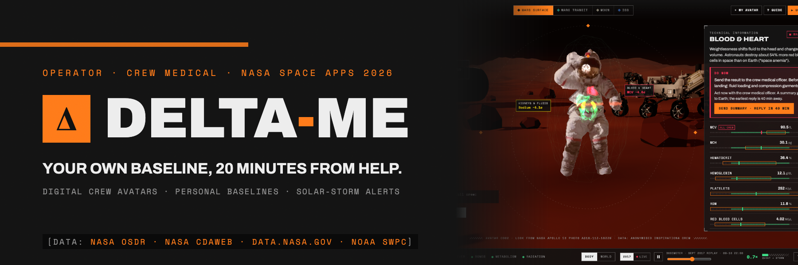
</p>

<p align="center">
  <b>A crew health console for astronauts who are far from a doctor.</b><br>
  Every astronaut gets a digital avatar of their own baseline, so changes that lab ranges miss can be spotted, and confirmed, before anyone acts.
</p>

<p align="center">
  <a href="https://delta-me-astronaut-health.netlify.app"><b>Live demo</b></a> ·
  <a href="video/renders/Pitch30.mp4"><b>30-second video</b></a> ·
  <a href="#abstract"><b>Abstract</b></a> ·
  <a href="#5-results"><b>Results</b></a> ·
  <a href="#9-run-it-locally"><b>Run it</b></a>
</p>

<p align="center">
  
  
  
  
</p>

## Abstract

On the way to Mars, the nearest doctor is up to 20 minutes away, one way. A question and its answer can take 40 minutes, so the crew has to notice health changes by themselves. The "normal ranges" printed on a lab report do not help much: they describe people living on Earth, not the astronaut holding the report.

**Delta-Me** gives every crew member a digital avatar that stores their own pre-flight baseline, and asks a sharper question: *is this normal for you?* We tested the idea on real blood data, published in NASA's Open Science Data Repository, from the four civilians of Inspiration4, a 3-day orbital flight in 2021. The day after landing, the lab ranges called every red-cell size (MCV) result normal. Measured against each person's own baseline, MCV had fallen in all four crew members, by 3.4 standard deviations (SD) on average. One SD is the usual wobble between one person's tests. A crew-wide shift that size is rare: at the three later draws, none of 88 complete crew-wide checks reached 3 SD (the largest was 2.7). But MCV itself stayed low after the flight, so these data show a real change that the lab ranges hid, not proof that the flight caused it.

One odd value is often just luck. With only three baseline draws, about 3% of tests land beyond 3 SD by chance. So a value that is unusual only for that person gets a repeat test (**Caution**). It becomes a **Warning** only when the shift is confirmed, by the whole crew or by a repeat draw. A value outside the lab range is a Warning at once. The same console replays the real ISS dosimeter record of the September 2017 solar storm: a simple onboard rule stayed quiet from 4 to 10 September, then fired a storm-shelter Warning at 05:52 UTC on 11 September. Its quiet level, window and thresholds were set on this same record, so this is a replay, not a test on new data. The console can also follow NOAA's live proton feed. Every alert says what to do now and how long Earth will take to reply.

Four people on one 3-day flight make this a hypothesis worth flying, not a proven effect.

| | Result | Data |
|---|---|---|
| **Lab ranges, day after landing** | Red-cell size (MCV) normal for all 4 crew: 87.0–90.5 fL, inside the 80–100 fL range | NASA OSDR OSD-569 |
| **Own baseline, same draw** | MCV down in all 4 crew: −2.84 to −4.61 SD, mean −3.44 SD | 3 pre-flight draws per person |
| **How rare is that?** | None of 88 complete crew-wide checks at R+45, R+82 and R+194 (days after return) reached 3 SD; the largest was 2.70 SD | NASA OSDR OSD-569, OSD-575 |
| **Did it recover?** | No. MCV stayed below baseline at every later draw: −3.98 SD at R+194 in the 3 crew measured. Cause unknown | NASA OSDR OSD-569 |
| **Single odd values** | 4 of 123 results beyond 3 SD the day after landing (R+1), with 3.9 expected by chance: repeat the draw | NASA OSDR OSD-569, OSD-575 |
| **Solar storm on the ISS** | No false alarm Sept 4–10 (max 1.50× the quiet level); Warning at 05:52 UTC Sept 11; peak 13.3×. Rule tuned on this same record | NASA CDAWeb, ISS TEPC |

## At a glance

<table>
  <tr>
    <td width="50%">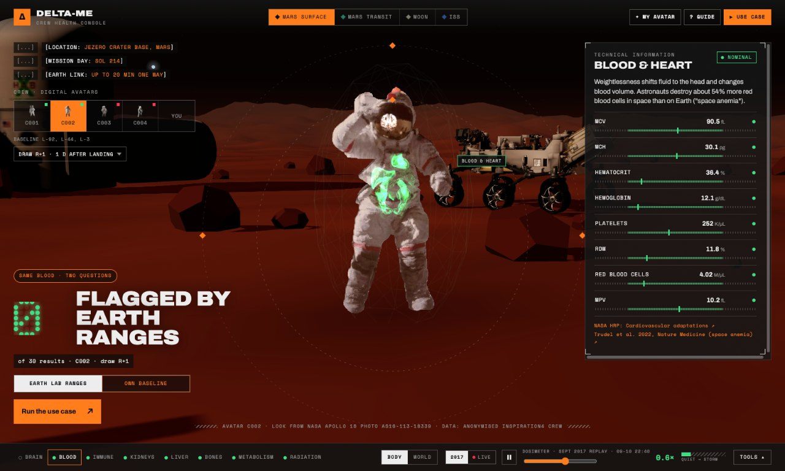</td>
    <td width="50%">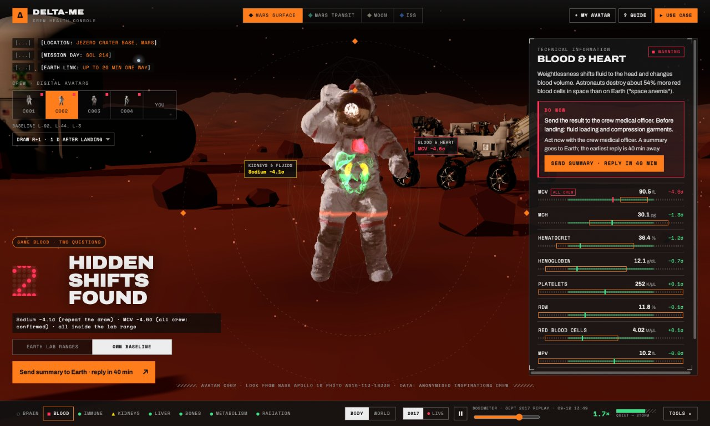</td>
  </tr>
  <tr>
    <td><b>Question 1: is it normal on Earth?</b> Against the lab ranges, none of C002's 30 results is flagged the day after landing.</td>
    <td><b>Question 2: is it normal for this person?</b> Against C002's own baseline, two hidden shifts appear. MCV is confirmed by the whole crew (Warning). Sodium needs a repeat draw (Caution).</td>
  </tr>
</table>

## Contents

1. [The problem](#1-the-problem)
2. [The idea: compare each astronaut with themselves](#2-the-idea-compare-each-astronaut-with-themselves)
3. [Data](#3-data)
4. [Methods](#4-methods)
5. [Results](#5-results)
6. [The console, screen by screen](#6-the-console-screen-by-screen)
7. [How Delta-Me answers the challenge](#7-how-delta-me-answers-the-challenge)
8. [Architecture and tech stack](#8-architecture-and-tech-stack)
9. [Run it locally](#9-run-it-locally)
10. [Limitations](#10-limitations)
11. [What's next](#11-whats-next)
12. [References](#12-references)

## 1. The problem

The NASA Space Apps challenge asks for software that "gathers health indicators and enables astronauts to evaluate and act on the status of their health" [1]. NASA groups the risks of human spaceflight into five hazards: space radiation, isolation and confinement, distance from Earth, gravity fields, and hostile closed environments [2]. Two of them, distance from Earth and space radiation, shape this project most directly. A third problem is about measurement: what counts as normal for one person.

### 1.1 The doctor is far away

| Where the crew is | One-way signal delay | Earliest reply from Earth |
|---|---|---|
| ISS, 408 km up | near real-time (relayed through NASA's TDRS satellites, about 0.6–1 s) [3] | now |
| Moon, Artemis base camp | 1.3 s (384,400 km ÷ speed of light) | 2.6 s |
| Mars transit or Mars surface | up to 20 min [4] | up to 40 min |

On Mars, "call the flight surgeon" becomes "send a message and wait up to 40 minutes". The crew has to judge their own results and act first. NASA calls this shift *Earth-independent medical operations* [5].

### 1.2 "Normal" was measured on Earth

A lab report flags a value when it falls outside the reference range: the band that most healthy adults fall into. That band is wide because people differ a lot from each other. For most markers, one person's own values move less, and for some, like red-cell size, much less. So a value can sit comfortably inside the population's range and still be a big change for that person.

<picture>
  <source media="(prefers-color-scheme: dark)" srcset="docs/figures/fig1-own-range-dark.png">
  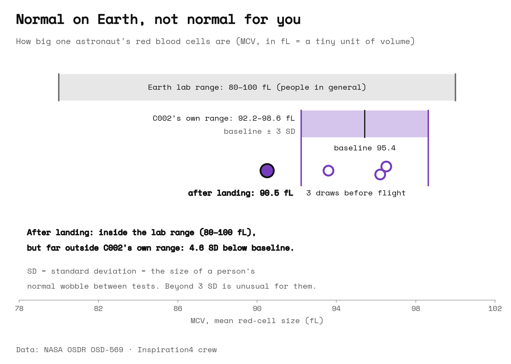
</picture>

*Figure 1. One astronaut, one blood marker. Red-cell size (MCV) for Inspiration4 crew member C002. The day after landing, 90.5 fL is inside the Earth lab range (80–100 fL) but 4.6 SD below C002's own pre-flight values.*

### 1.3 Some dangers cannot be felt

Solar storms throw out fast protons that pass through spacecraft walls. Nobody can see or feel them; only a dosimeter can [6]. A crew needs a rule that says when to go to the storm shelter, even when Earth is 40 minutes away.

### 1.4 Our questions

1. Does comparing each astronaut with their own baseline catch real changes that Earth lab ranges miss?
2. Can we keep false alarms low when each person has only a few baseline measurements?
3. Can a simple onboard rule turn dosimeter data into a shelter warning that is quiet when space is calm and fast when it is not?

## 2. The idea: compare each astronaut with themselves

Δ (delta) means change. Delta-Me measures change from **you**, not from the average person on Earth.

1. **A digital avatar for each astronaut.** It holds that person's pre-flight baseline for every blood marker and shows eight body systems on a 3D body, each Nominal, Caution or Warning.
2. **Two questions for the same blood.** "Is this normal on Earth?" (lab range) and "Is this normal for this person?" (own baseline). One switch flips between them, so the crew sees exactly what the lab range misses.
3. **Confirm, then act.** One value that is odd only for that person is a Caution: repeat the draw. It becomes a Warning when the rest of the crew shifts the same way or a repeat draw confirms it. A value outside the lab range is a Warning at once.
4. **Escalation that knows the distance.** Every Warning says what to do now, who to tell, and when Earth's reply can arrive.
5. **Radiation you cannot feel.** A real dosimeter replay of the 2017 storm, or NOAA's live satellite feed, drives a storm-shelter alert.

## 3. Data

All data are public. Nothing in this repository identifies a person: the four Inspiration4 crew members appear as C001–C004, as in NASA's release.

| Dataset | What it contains | Used for |
|---|---|---|
| NASA OSDR [OSD-569](https://osdr.nasa.gov/bio/repo/data/studies/OSD-569) | Inspiration4 complete blood count: red cells, platelets, white cells, with lab reference ranges | Blood and immune systems |
| NASA OSDR [OSD-575](https://osdr.nasa.gov/bio/repo/data/studies/OSD-575) | Inspiration4 comprehensive metabolic panel: kidney, liver, glucose and bone markers, with lab reference ranges | Kidney, liver, metabolism and bone systems |
| NASA CDAWeb, [ISS TEPC dose analyzer](https://data.nasa.gov/dataset/iss-tissue-equivalent-proportional-counter-tepc-dose-analyzer-10-s-data-61b24) | ISS radiation dose rate with the station's latitude and longitude, Sept 4–15, 2017 | Storm replay and detector |
| data.nasa.gov, [Flight Crew Physiological Data for Crew State Monitoring](https://data.nasa.gov/dataset/flight-crew-physiological-data-for-crew-state-monitoring) | ECG, breathing and skin conductance at 256 Hz from pilots in attention and startle experiments, with labels | Readiness model |
| NOAA SWPC, [GOES proton flux](https://www.swpc.noaa.gov/products/goes-proton-flux) and [space weather scales](https://www.swpc.noaa.gov/noaa-scales-explanation) | Live ≥10 MeV and ≥100 MeV proton flux, the current storm level, and the chance of a storm today | Live radiation mode |
| NASA 3D Resources, NASA Image and Video Library, NASA Visible Earth | Spacecraft and astronaut models, Apollo EVA photos, Earth textures | 3D worlds and crew looks |
| HuBMAP CCF 3D Reference Object Library v1.2 | Anatomical organ meshes (CC BY 4.0) | Organs inside the avatar |

**Inspiration4** was a private SpaceX orbital flight of 3 days in September 2021, with four civilian crew members. NASA's Open Science Data Repository publishes its biomedical data. Their blood was drawn three times before launch (L-92, L-44 and L-3: days before launch) and four times after return (R+1, R+45, R+82 and R+194: days after return). There were no in-flight draws, so the day-after-landing draw stands in for "in flight". 31 blood markers had enough data for a personal baseline.

## 4. Methods

Each method starts with a plain-words summary. Open *Technical details* for the formulas, thresholds and code.

### 4.1 Your own normal (personal baseline)

**In plain words.** Your blood values wobble a little from one test to the next. Delta-Me learns each person's usual value (the average of their three pre-flight draws) and the usual size of the wobble (the standard deviation, SD). Three draws are too few to measure one person's wobble, so the SD is pooled across all four crew members. A new result is then described as "how many wobbles from your normal". That number is the z-score: −4.6 SD means 4.6 wobbles below normal.

<details>
<summary><b>Technical details</b></summary>

For person *p* and marker *a*:

- **Baseline:** μ<sub>p,a</sub> = mean of the pre-flight values (L-92, L-44, L-3). A few series have fewer: MCH has two for C003 and C004, and C002 has no pre-flight MCHC, so it gets no MCHC z-score (which is why there are 123 checks, not 124).
- **Wobble:** one SD per marker, pooled across the crew from each person's deviations from their own mean: SD<sub>a</sub> = √( Σ (x − μ<sub>p,a</sub>)² / (N − n<sub>people</sub>) ). With 4 crew × 3 draws that is 12 − 4 = **8 degrees of freedom**. It measures how much one person varies, not how much people differ from each other.
- **z-score of a new value:** z = (x − μ<sub>p,a</sub>) / SD<sub>a</sub>.
- **How often |z| ≥ 3 happens by chance.** The textbook answer is 0.27%, but two things make it more likely here: the SD is estimated from few draws, and the baseline is itself an average of only three values. Treating a new value's deviation as Student-t with 8 degrees of freedom and scale SD·√(1 + 1/3) gives

  P(|z| ≥ 3) = P(|t<sub>8</sub>| ≥ 3 / √(4/3)) ≈ **0.032**, about 4 of every 123 checks.

Code: [`scripts/build_crew.py`](scripts/build_crew.py) computes baselines, SDs, z-scores and confirmations into [`app/public/data/crew.json`](app/public/data/crew.json). [`app/src/data.ts`](app/src/data.ts) turns them into statuses.

</details>

### 4.2 Confirm, then act

**In plain words.** About one test in 30 lands beyond 3 SD by luck, so one odd value proves little. A real change should show up again: in the other crew members, who share the same spacecraft, or in the same person's next test. For a value still inside the lab range, Delta-Me only escalates when one of those happens.

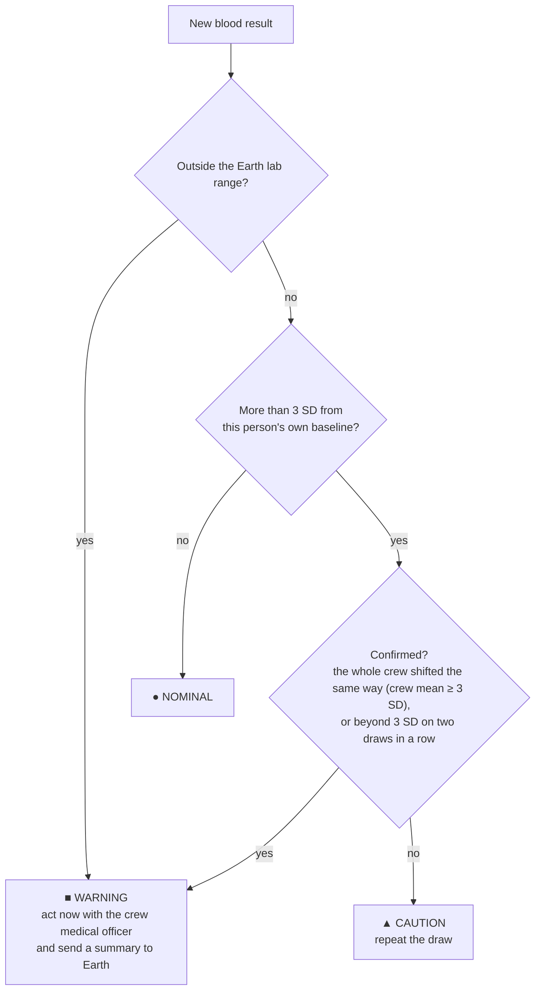

<details>
<summary><b>Technical details</b></summary>

- **Crew-wide confirmation:** at a return draw, all four crew members have a z-score for that marker, all z-scores have the same sign, and |mean z| ≥ 3. Every crew member's value for that marker is then confirmed at that draw. This is how C004's −2.84 SD is flagged.
- **Repeat confirmation:** the same person is beyond 3 SD, in the same direction, on two consecutive return draws.
- **Confirmed in the data:** MCV for all four crew at R+1 (crew-wide), MCV for C003 at R+45 (repeat), and alkaline phosphatase for C003 at R+82 (repeat).
- In the console, *Earth lab ranges* mode asks only the first question (outside the range means Warning). *Own baseline* mode runs the whole tree above.
- The status words follow NASA's caution-and-warning convention. Every status has a shape as well as a colour (● ▲ ■ ○), so nothing depends on colour alone.

</details>

### 4.3 Solar storm detector (dosimeter replay)

**In plain words.** The ISS passes two kinds of radiation "hot spots" every day. One is a weak spot in Earth's magnetic field over the South Atlantic (the South Atlantic Anomaly), which raises the dose every day, storm or not. The other is the high-latitude part of each orbit (the ISS reaches about 52° north and south, not the poles), where solar particles can get in. Only the high-latitude passes tell you about a solar storm. So the rule keeps the dose measured at high latitude outside the South Atlantic spot, averages the last 3 hours, and compares it with the quiet days before (Sept 4–9). Twice the quiet level means go to the shelter.

<details>
<summary><b>Technical details</b></summary>

- **Input:** ISS TEPC (Tissue-Equivalent Proportional Counter) dose-equivalent rate in µSv/min, with the station's latitude and longitude: 17,155 samples, about one per minute, from 4 to 15 September 2017.
- **Filter:** |latitude| ≥ 40° and outside the South Atlantic Anomaly box (−90° < longitude < 10° and −50° < latitude < 5°).
- **Quiet baseline:** mean filtered rate over 4–9 September = 0.548 µSv/min.
- **Detector:** ratio = mean filtered rate over the last 180 minutes ÷ quiet baseline. The ratio stays at 1 while the window holds 3 or fewer filtered samples.
- **Thresholds:** **Caution at ≥ 1.7×** (spend sleep and rest periods in the most shielded area) and **Warning at ≥ 2×** (go to the storm shelter now and follow the vehicle procedure).
- **Why 3 hours:** the station spends only part of each 92-minute orbit at high latitude. On this record, 30- and 45-minute windows gave false Cautions on the quiet days (the 30-minute one also a false Warning). Windows of 60 to 120 minutes stayed quiet but came closer to the Caution line (up to 1.66×, against 1.50× for 3 hours), and would have warned earlier: 04:23 with 60 minutes, 05:03 with 90, against 05:52. We kept 3 hours for the safety margin; a shorter window would trade some margin for earlier warnings.
- **One clock for every scenario:** the replay runs in all four scenarios as the event clock. Outside Earth's magnetic shield (Moon, Mars transit, Mars) the same storm would arrive sooner and hit harder. The console says so, instead of pretending the ISS record is a deep-space record.
- **Context:** real spacecraft already carry dosimeters with onboard alarms. Delta-Me shows the same quiet-baseline logic running on public data inside the crew's health console.

Code: [`app/src/useReplay.ts`](app/src/useReplay.ts), with data from [`scripts/build_radiation.py`](scripts/build_radiation.py).

</details>

### 4.4 Live space weather (NOAA)

**In plain words.** Switch the radiation monitor to *Live* and Delta-Me reads NOAA's satellite measurements of solar protons near Earth every 5 minutes, works out the storm level (S0 to S5) from them with NOAA's thresholds, and shows NOAA's chance of a storm today.

<details>
<summary><b>Technical details</b></summary>

| NOAA level | ≥10 MeV protons (pfu) | Delta-Me status |
|---|---|---|
| S0 | < 10 | ● Nominal, unless ≥100 MeV protons reach 1 pfu (then ▲ Caution) |
| S1 minor | ≥ 10 | ▲ Caution: limit EVA, be ready to shelter |
| S2 moderate | ≥ 100 | ▲ Caution |
| S3 strong | ≥ 1,000 | ■ Warning: go to the storm shelter |
| S4 severe, S5 extreme | ≥ 10,000, ≥ 100,000 | ■ Warning |

- **Why S3:** it is the first NOAA level whose description names astronauts ("radiation hazard avoidance recommended for astronauts on EVA") [7].
- **Why ≥100 MeV protons:** they get through spacecraft walls, and 1 pfu is NOAA's alert threshold for them. A National Research Council review of ISS radiation rules notes that at that level an "energetic" solar particle event is declared and NASA's Space Radiation Analysis Group stays on console [15].
- **Feeds:** `services.swpc.noaa.gov/json/goes/primary/integral-protons-1-day.json` and `services.swpc.noaa.gov/products/noaa-scales.json` (public, no key, readable from the browser). Polled when Live is switched on, then every 5 minutes.
- **Limitation:** this is near-Earth data from geostationary orbit, not a dosimeter on the crew's own vehicle.

Code: [`app/src/useLive.ts`](app/src/useLive.ts).

</details>

### 4.5 Escalation that knows the distance

**In plain words.** "Call the doctor" means different things on the ISS and on Mars. Delta-Me computes the earliest possible reply (twice the one-way delay) and changes its advice. On the ISS: call the flight surgeon now. On the Moon: call, and expect a short audio lag. On Mars: act now with the crew medical officer, and send a summary to Earth. The app plans for the longest delay: a reply 40 minutes later.

<details>
<summary><b>Technical details</b></summary>

- `eta = 2 × one-way delay`: "now" on the ISS, "2.6 s" on the Moon, "40 min" in Mars transit and on the Mars surface.
- A Warning in any body system other than radiation (which has its own shelter alert) shows **Send summary to Earth · reply in {eta}**. It opens a ready-to-copy report for the flight surgeon: place, mission day, person, draw and comparison mode; every system at Caution or Warning and, for a crew member's blood draw, each flagged value with its lab range and z-score; and the current radiation status.
- The storm banner (an ARIA `alert`) ends with "ground reply in 40 min: act now" on Mars, and stays until the crew presses *I'm in the shelter* or the Warning ends.

</details>

### 4.6 Self-assessment between blood tests

**In plain words.** Blood tests are not daily. For the days in between, each astronaut can log a one-minute check-in, take a 20-second pulse with the laptop camera, and look at a readiness model trained on NASA crew-state data. All of it stays on the device.

<details>
<summary><b>Daily check-in</b> (thresholds)</summary>

| Indicator | Caution | Warning | Source shown in the app |
|---|---|---|---|
| Resting heart rate | < 50 or > 100 bpm | < 40 or > 120 bpm | AHA: resting adult range 60–100 bpm (the < 50, < 40 and > 120 limits are the app's own) |
| Blood pressure, systolic | ≥ 130 mmHg | ≥ 140 or < 90 mmHg | AHA 2017 categories |
| Blood pressure, diastolic | ≥ 80 mmHg | ≥ 90 mmHg | AHA 2017 categories |
| Fasting glucose | < 70 or ≥ 100 mg/dL | < 54 or ≥ 126 mg/dL | ADA |
| Body temperature | ≥ 38 °C | ≥ 39 °C | fever threshold, not adjusted for space; resting core temperature rose about 1 °C over months on the ISS [8] |
| Sleep last night | < 7 h | < 5 h | AASM/SRS: adults need at least 7 h |
| Mood (1–5) | ≤ 2 | ≤ 1 | self-rating, shared only in a private medical conference |

Once an indicator has three earlier entries, each new value (except mood) is also compared with the person's own history (|z| ≥ 2 Caution, |z| ≥ 3 Warning), and the stricter rule wins. Three entries give only a rough SD. By the reasoning in §4.1, even when nothing has changed, a new value then lands beyond 2 SD about 1 time in 4, and beyond 3 SD about 1 time in 8. Entries and the streak counter live in the browser's `localStorage`.

</details>

<details>
<summary><b>Camera pulse</b> (remote photoplethysmography)</summary>

With every heartbeat the skin changes colour very slightly, and a camera can see it. Delta-Me averages the green channel inside a forehead box, resamples it to 30 Hz, removes slow drift (a moving average of about 1 s), applies a Hann window and finds the strongest frequency between 0.7 and 3.0 Hz (42–180 bpm) over 20 seconds. If the signal quality (peak power ÷ mean power in that band) is below 4, it asks for a re-measure. The first three good readings become the resting baseline, and later readings show their distance from it (with the SD floored at 5 bpm). Frames never leave the browser. This is a demonstration, not a medical device.

</details>

<details>
<summary><b>Readiness model</b> (NASA crew-state data)</summary>

- **Data:** NASA's Flight Crew Physiological Data for Crew State Monitoring. The subjects are pilots, not astronauts, in three controlled experiments (channelized attention, diverted attention, startle/surprise), with labels for when the state was induced.
- **Features** per 20-second window (5-second step): heart rate from ECG R-peaks, breathing rate, and skin conductance, each z-scored against the same person's resting windows.
- **Model:** logistic regression written in NumPy (L2 = 0.1, class-balanced).
- **Validation:** leave-one-subject-out: train on two subjects, test on the third. On the held-out subject, the AUC for telling induced states from rest was 0.85, 0.79 and 0.76 (subjects 10, 5 and 9), where 1.0 is perfect and 0.5 is chance. The held-out subject's features are still z-scored against their own labelled rest windows, so a new person needs a labelled rest period first.
- **Caveats:** three subjects, and the labels follow the experiment timeline, so part of the signal may be drift over the session.

Code: [`scripts/build_readiness.py`](scripts/build_readiness.py), [`app/src/Readiness.tsx`](app/src/Readiness.tsx).

</details>

### 4.7 A digital avatar from one photo

**In plain words.** Take one photo, ideally full body (head and shoulders is enough). The browser finds your pose, cuts you out of the background, and builds an approximate 3D model of you as a cloud of small coloured dots ("Gaussian splats"), with organs placed inside to match your proportions. The photo never leaves your device.

<details>
<summary><b>Technical details</b></summary>

- **Pose and cut-out:** MediaPipe Pose Landmarker (full model: 33 landmarks plus a segmentation mask), served from the app's own files and run in the browser on the GPU, with a CPU fallback. The head and both shoulders must be visible.
- **Per-part splatting:** each body pixel joins the nearest body part (head, torso, upper arms, forearms, thighs, shins). Its depth comes from its distance *d* to the part's bone axis and the part's half-width *w* there (a distance transform of the outline): z = k·√(w² − d²). That gives rounded limbs and an elliptical torso. Each pixel makes a front splat in its photo colour and a darker back splat. Parts the photo does not show stay as a hologram.
- **Organs** (brain, heart, liver, spleen, pancreas, kidneys, pelvis) are anchored to the pose and scaled by shoulder width.
- **Honest label:** depth is estimated from one photo, not scanned. This is single-photo, per-part splatting, not a multi-view 3D Gaussian Splatting reconstruction.
- **Crew looks:** C001–C004 were built with the same pipeline from public-domain Apollo 11, 16 and 17 EVA photographs. They are illustrations only. The people in those photos are not the anonymous Inspiration4 crew whose blood data is shown.

Code: [`app/src/Onboarding.tsx`](app/src/Onboarding.tsx), [`app/src/avatar.ts`](app/src/avatar.ts), [`app/src/Body3D.tsx`](app/src/Body3D.tsx).

</details>

## 5. Results

### 5.1 The lab range said "normal". Each person's baseline said "changed".

<picture>
  <source media="(prefers-color-scheme: dark)" srcset="docs/figures/fig2-mcv-two-questions-dark.png">
  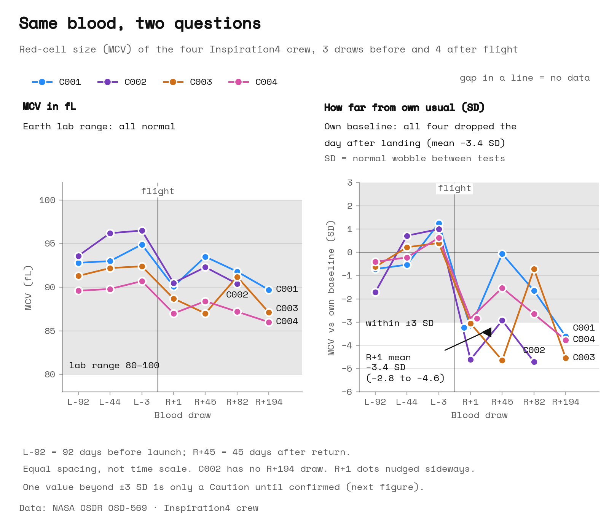
</picture>

*Figure 2. Red-cell size (MCV) for the four Inspiration4 crew members across seven blood draws. Left: against the Earth lab range, every value is normal. Right: against each person's own pre-flight baseline, all four dropped the day after landing.*

| Crew member | Own baseline (mean of 3 pre-flight draws) | Day after landing (R+1) | Inside the 80–100 fL lab range? | Distance from own baseline |
|---|---|---|---|---|
| C001 | 93.6 fL | 90.1 fL | yes | −3.24 SD |
| C002 | 95.4 fL | 90.5 fL | yes | −4.61 SD |
| C003 | 92.0 fL | 88.7 fL | yes | −3.06 SD |
| C004 | 90.0 fL | 87.0 fL | yes | −2.84 SD |
| **Crew mean** | | | | **−3.44 SD** |

Across all 123 results at R+1, the lab ranges flagged 5, and none of them was red-cell size. The personal baselines found four values that were inside the lab range but beyond 3 SD: MCV in three crew members, and sodium in C002 (−4.08 SD). Red blood cells are known to change on long missions: on six-month flights, 14 astronauts destroyed about 54% more red blood cells than on Earth, which contributes to "space anemia" [9]. Whether a 3-day flight does anything similar is not known. A shift in red-cell size is still the kind of change a crew would want to see early.

Figure 2 also shows that MCV stayed low at the later draws. Section 5.2 and the limitations come back to what that means.

### 5.2 One odd value is luck. A crew-wide shift is not.

<picture>
  <source media="(prefers-color-scheme: dark)" srcset="docs/figures/fig3-confirmation-dark.png">
  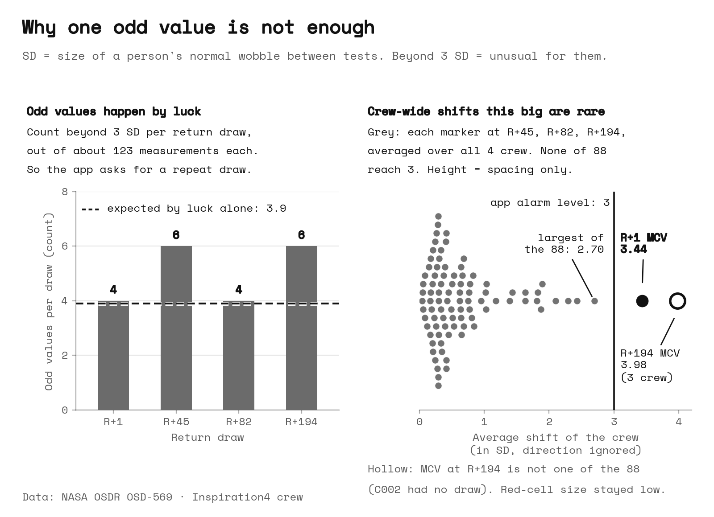
</picture>

*Figure 3. Left: how many results landed beyond 3 SD at each return draw, compared with the 3.9 expected by chance. Right: the crew's average shift for every marker at the later draws where all four crew were measured (88 grey dots), the red-cell shift the day after landing (filled dot), and red-cell size at R+194, where only three crew members were measured (hollow dot).*

Counting odd values alone would have found nothing. Four of 123 at R+1 is what chance predicts (3.9), and the later draws look the same (6, 4 and 6). What stands out is the **pattern**. Three of the four odd values were MCV, all moving down, and the fourth crew member's MCV fell too (C004, −2.84 SD, just short of 3 SD). The fourth odd value was sodium in C002. A crew-wide shift that size is rare: across the 88 marker-and-draw pairs at R+45, R+82 and R+194 where all four crew were measured, the crew's average shift never reached 3 SD (the largest was 2.70). At R+1, MCV reached 3.44. That is why Delta-Me treats a single crossing as "repeat the draw", and a crew-wide or repeated shift as a Warning.

MCV did not simply recover, though. Its crew shifts at R+45 and R+82 (−2.29 and −2.43 SD) are the second and third largest of the 88. MCV at R+194 is left out only because C002 has no MCV value there; the other three crew members averaged −3.98 SD, each more than 3 SD low (the hollow dot in Figure 3). So the later draws are not a clean "back to normal" reference for MCV, and this comparison describes the data; it is not a formal test.

### 5.3 The 2017 solar storm, as the ISS dosimeter saw it

<picture>
  <source media="(prefers-color-scheme: dark)" srcset="docs/figures/fig4-storm-dark.png">
  
</picture>

*Figure 4. Top: Delta-Me's storm detector on the real ISS dosimeter record (dose at high latitude, outside the South Atlantic Anomaly, over the last 3 hours, relative to the quiet days of 4–9 September). Middle: total dose per day. Bottom: a zoom on 10–11 September.*

| Time (UTC) | What happened |
|---|---|
| Sept 10, 16:06 | An X8.2 solar flare peaks |
| Sept 10, 16:25 | NOAA's GOES satellite sees ≥100 MeV protons rise |
| Sept 10, 16:45 | NOAA issues an S1 radiation storm alert (the storm later reached S3, the level Delta-Me's live rule treats as a Warning) |
| Sept 11, 04:15 | The dose inside the ISS rises clearly, on a high-latitude pass |
| **Sept 11, 05:52** | **Delta-Me: Warning, go to the storm shelter (2.04× the quiet level)** |
| Sept 11, 09:51 | Peak: 13.3× the quiet level |

- **No false alarms on the quiet days.** From Sept 4 until NOAA's alert on Sept 10, the detector peaked at 1.50×, below the 1.7× Caution line. The quiet level was measured on Sept 4–9, so this checks the rule on the days that set it, not on new data.
- **Quick once the particles arrived.** The Warning fired 1 h 37 min after the dose inside the station clearly started to rise (a 60-minute window would have warned at 04:23; see §4.3).
- **How long it lasted.** The Warning held from 05:52 to 15:10 UTC on Sept 11, and came back on Sept 12 from 07:13 to 13:25 (up to 2.7×) while the storm's tail passed. Nothing fired after that.
- **The daily dose almost doubled:** 0.89 mSv (millisieverts, a unit of radiation dose) on Sept 10, 1.71 mSv on Sept 11.
- **Why did the station's dose rise about 12 hours after NOAA's alert?** Earth's magnetic field shields the ISS except on some high-latitude passes, and in this storm the most exposed ones were far south, below Australia. After the alert, the station's southern passes crossed other longitudes until early on Sept 11, and the ≥10 MeV proton flux near Earth kept rising until 11:45 that day. Mars has no global magnetic field, and during the same event the Curiosity rover measured dose rates about double the usual level on the Martian surface [10]. Beyond Earth's shield, a crew would want both rules, NOAA's live feed (§4.4) and their own dosimeter; the console offers them as two modes.

## 6. The console, screen by screen

<table>
  <tr>
    <td width="50%">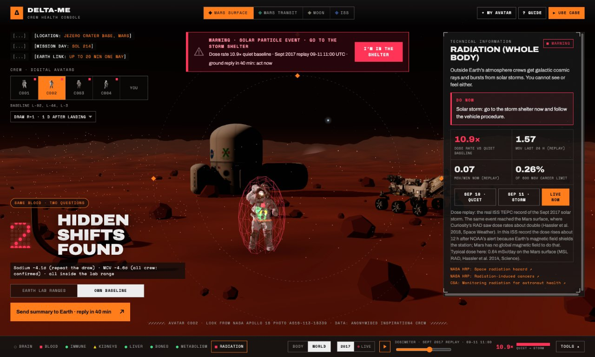</td>
    <td width="50%">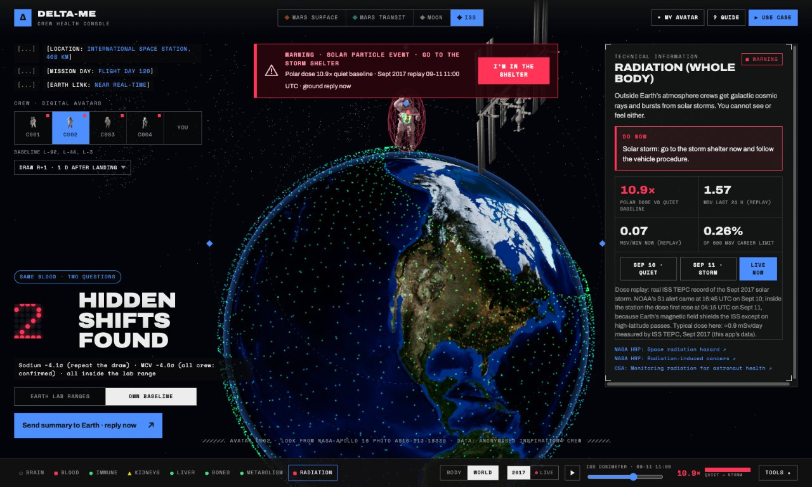</td>
  </tr>
  <tr>
    <td><b>Storm shelter alert.</b> The replay reaches 11 September on the Mars surface. The banner says what to do and that Earth's reply is 40 minutes away, so the crew acts first.</td>
    <td><b>ISS world.</b> Earth turns so that the station's real ground track from the dosimeter record is under the avatar. Each dot is a measurement, coloured by dose.</td>
  </tr>
  <tr>
    <td>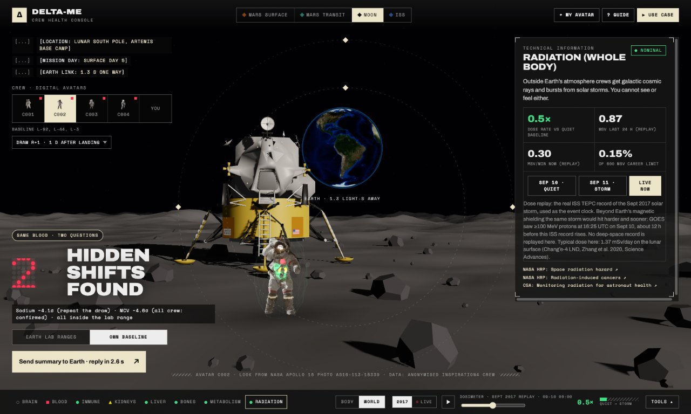</td>
    <td>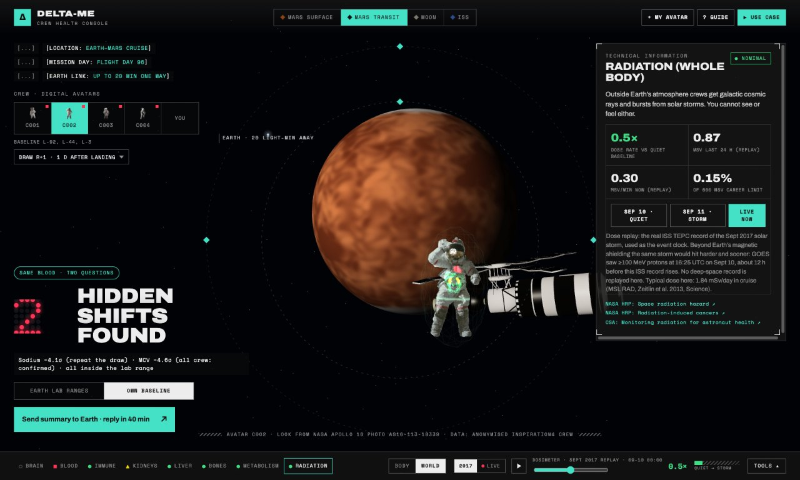</td>
  </tr>
  <tr>
    <td><b>Moon (Artemis).</b> Earth is 1.3 light-seconds away, so the advice becomes "call the flight surgeon now; expect a short audio lag". Typical dose: 1.37 mSv/day (Chang'e-4) [11].</td>
    <td><b>Mars transit.</b> A Skylab-type habitat in deep space. Typical dose: 1.84 mSv/day in cruise (Curiosity's RAD) [12]. The Mars surface base uses 0.64 mSv/day [13].</td>
  </tr>
  <tr>
    <td>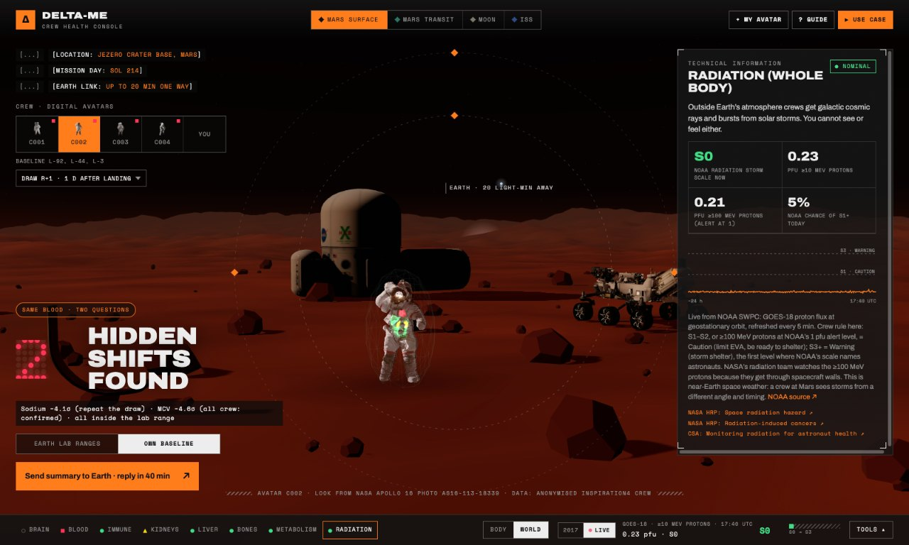</td>
    <td>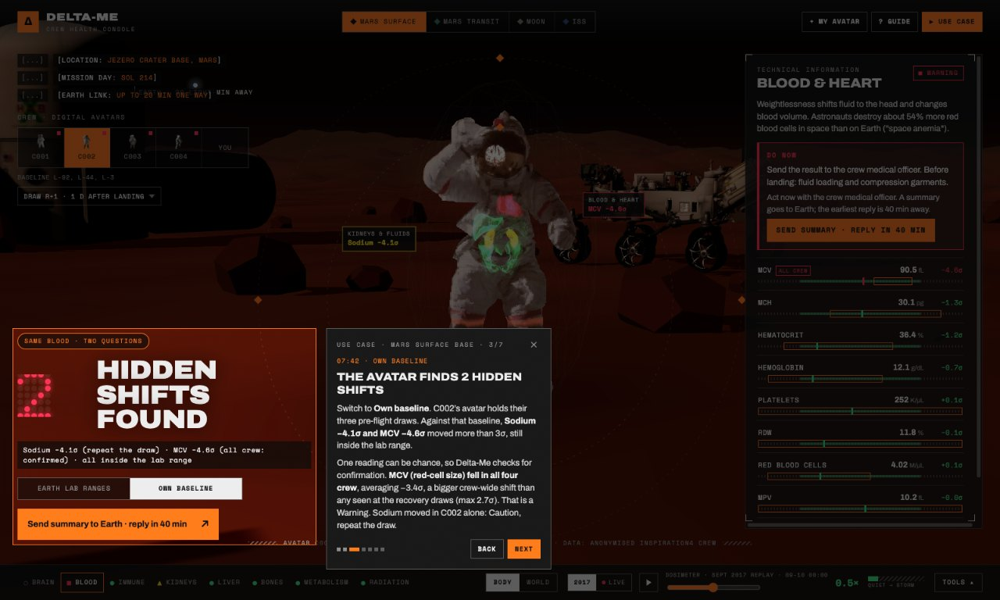</td>
  </tr>
  <tr>
    <td><b>Live NOAA feed.</b> GOES-18 proton flux, the storm level worked out from it, and NOAA's chance of a storm today, refreshed every 5 minutes (captured on 15 Nov 2026: S0, all quiet).</td>
    <td><b>Guided use case.</b> Seven steps follow C002 through a morning check on Mars: lab ranges, own baseline, acting without waiting for Earth, a solar storm, and a go/no-go self-check.</td>
  </tr>
  <tr>
    <td>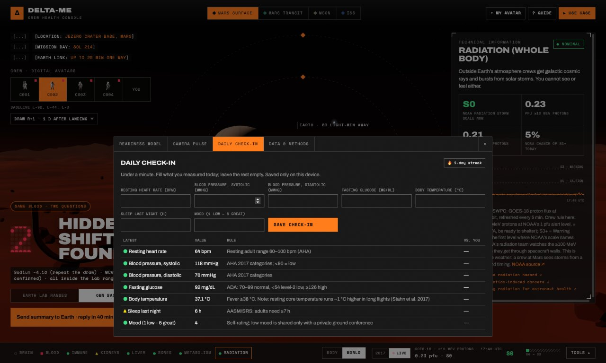</td>
    <td>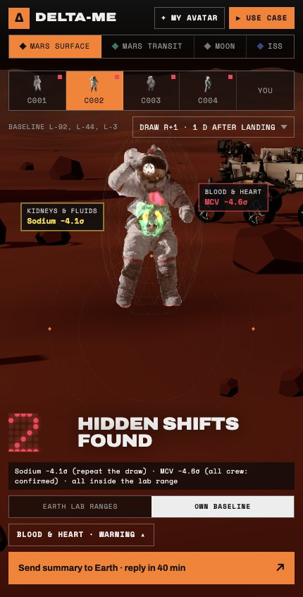</td>
  </tr>
  <tr>
    <td><b>Daily check-in.</b> Under a minute, with clinical cut-offs and, after three entries, the person's own history. Here, 6 h of sleep is a Caution.</td>
    <td><b>Works on phones.</b> The layout adapts down to phone width, with the technical panel as a bottom sheet.</td>
  </tr>
</table>

<p align="center">
  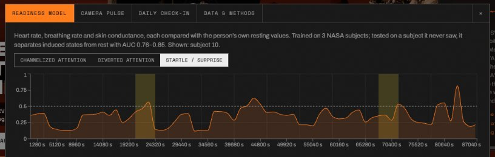
  <br><sub><b>Readiness model.</b> Shaded: the state NASA induced. Line: the model's estimate, from heart rate, breathing and skin conductance.</sub>
</p>

**Everything in the console**

- **Crew of digital avatars:** C001–C004 plus *You*. Each avatar's dot shows its worst status. A menu picks the blood draw, and the baseline is always the three draws before launch.
- **Eight body systems:** brain and readiness, blood and heart, immune system, kidneys and fluids, liver, bones and muscle, metabolism, and radiation. Each one shows what spaceflight does to it, what to do at Caution and at Warning, who to call, and its NASA sources. Organs glow on the 3D body by status.
- **Four mission scenarios:** Mars surface, Mars transit, Moon and ISS, each with its own 3D world (NASA models of the Habitat Demonstration Unit, the Perseverance rover, the Apollo Lunar Module, Skylab and the ISS), delay, typical dose and escalation advice.
- **Radiation monitor:** the 2017 dosimeter replay with play, pause and scrub, or the live NOAA feed. Shelter banner and acknowledgement.
- **Summary for the flight surgeon:** a copy-ready report with the earliest reply time.
- **Self-assessment tools:** readiness model, camera pulse, daily check-in with a streak counter, and a *Data & methods* page that lists every source, threshold and caveat.
- **Walkthroughs:** a 13-step interface guide and the 7-step use case (arrow keys to move, Esc to close).
- **Privacy:** the photo avatar, pulse readings and check-ins never leave the device.
- **Accessibility:** status always has a shape and a word as well as a colour; walkthroughs work from the keyboard; animations shorten when the system asks for reduced motion; the layout works from wide screens down to phones.

## 7. How Delta-Me answers the challenge

The challenge asks five questions about every health indicator [1].

| Challenge question | How Delta-Me answers it |
|---|---|
| Which measurements can be done in space? | Blood panels (31 markers from a complete blood count and a metabolic panel; the demo uses Inspiration4's pre-flight and post-landing draws), radiation (an ISS dosimeter replay, or live NOAA proton flux), a daily check-in (heart rate, blood pressure, glucose, temperature, sleep, mood), a 20-second camera pulse, and physiological readiness signals. |
| Why is the exam needed? | Each body-system card says what spaceflight does to that system (fluid shifts and "space anemia", bone loss of about 1–1.5% per month, immune changes, radiation you cannot feel) and links the NASA Human Research Program pages. |
| How do the hazards affect the indicator? | The body-system cards describe what spaceflight does to each system (for example weightlessness, isolation, radiation and the closed cabin) and link NASA's risk pages. The scenario sets the distance from Earth and the typical radiation dose, and the escalation advice changes with the distance. |
| When should a result go to the crew or to flight surgeons? | Explicit rules: Caution means a first step, such as repeating a blood draw or resting in the most shielded area. Warning means act now: with the crew medical officer in the Mars scenarios, or by calling the flight surgeon on the Moon and the ISS. A summary for Earth is one click away, with the earliest reply time shown (twice the one-way delay). |
| What actions prevent a critical condition? | Every system has a Caution action and a Warning action: for example, go to the storm shelter; fluid loading and compression garments before landing; don't skip resistive exercise; fast carbohydrate and re-measure in 15 minutes for low glucose. |

## 8. Architecture and tech stack

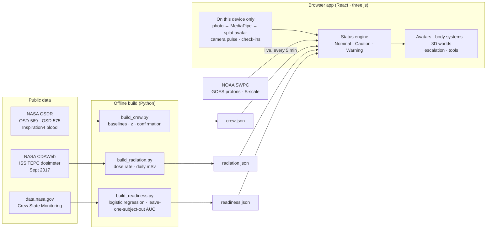

The app is a static site: the Python scripts turn raw NASA files into three small JSON files, and everything else runs in the browser. There is no backend and no account. The only network calls at run time are the NOAA feeds (in Live mode) and Google Fonts.

| Layer | Tools |
|---|---|
| App | React 19, TypeScript, Vite 8, oxlint |
| 3D | three.js, React Three Fiber, drei; NASA 3D Resources models; HuBMAP organ meshes; custom splat shader |
| Computer vision | MediaPipe Tasks Vision (Pose Landmarker), run in the browser |
| Charts and motion | Recharts; Remotion for the intro poster, the dot-matrix numbers and the pitch video |
| Data pipeline | Python 3 (standard library; NumPy for the readiness model) |
| Figures | matplotlib ([`docs/figures/make_figures.py`](docs/figures/make_figures.py)) |
| Hosting | Netlify (static build) |

```text
.
├── app/                 the web app (Vite + React + TypeScript)
│   ├── src/
│   │   ├── App.tsx          layout, panels, walkthroughs, escalation
│   │   ├── data.ts          data types and status rules
│   │   ├── content.ts       body systems, scenarios, actions, sources
│   │   ├── useReplay.ts     2017 storm replay and detector
│   │   ├── useLive.ts       live NOAA feed and crew rule
│   │   ├── World3D.tsx      the four 3D worlds
│   │   ├── Body3D.tsx       avatar, organs and splat rendering
│   │   ├── Onboarding.tsx   photo-to-avatar flow
│   │   ├── avatar.ts        per-part Gaussian splatting
│   │   ├── Readiness.tsx, Pulse.tsx, CheckIn.tsx   self-assessment tools
│   │   └── remotion/        intro poster and dot-matrix numbers
│   └── public/          data JSON, 3D models, textures, pose model
├── scripts/             raw NASA data → app/public/data/*.json
├── video/               Remotion pitch video, data clips and this README's banner
├── docs/                banner, figures (with their generator) and screenshots
└── research/            challenge notes, dataset survey and literature maps
```

## 9. Run it locally

You need Node.js 22.12 or newer.

```bash
git clone https://github.com/MetaNetMx/Nasa-2026-hackaton.git
cd Nasa-2026-hackaton/app
npm install
npm run dev      # open http://localhost:5173
npm run build    # type-check and build the static site into app/dist
```

The processed data ships with the repo, so the steps below are optional.

<details>
<summary><b>Rebuild the data from NASA's raw files</b></summary>

The raw files (about 1.1 GB) are not in the repository. Put them under `data/raw/`, then run the scripts from the repository root:

```bash
# Inspiration4 blood panels from NASA OSDR (OSD-575 and OSD-569) into data/raw/osdr/:
#   LSDS-8_Comprehensive_Metabolic_Panel_CMP_TRANSFORMED.csv
#   LSDS-7_Complete_Blood_Count_CBC_TRANSFORMED.csv
python3 scripts/build_crew.py         # → app/public/data/crew.json

# Downloads the ISS TEPC record from NASA CDAWeb if it is not cached yet
python3 scripts/build_radiation.py    # → app/public/data/radiation.json

# Crew State Monitoring subjects in data/raw/datanasa/csm/{subject}/ (needs NumPy)
python3 scripts/build_readiness.py    # → app/public/data/readiness.json
```

</details>

<details>
<summary><b>Rebuild the figures, the video and the banner</b></summary>

```bash
python3 -m pip install matplotlib numpy                       # the figure script needs these
python3 docs/figures/make_figures.py                          # the four README figures (light and dark)

cd video && npm install
npx remotion studio src/index.ts                              # preview every composition
npx remotion render src/index.ts Pitch30 renders/Pitch30.mp4  # the 30-second pitch
npx remotion still src/index.ts Banner ../docs/banner.png     # this README's banner
```

</details>

## 10. Limitations

We would rather show the limits than hide them.

- **Small sample.** Four people on one 3-day flight. The R+1 shift is a hypothesis to test on longer missions, not a proven effect.
- **No in-flight blood.** Inspiration4 had no in-flight draws, so the day after landing stands in for "in flight". Landing itself (fluids shifting back under gravity) may be part of what R+1 shows.
- **Three baseline draws.** Personal ranges are only as good as the baseline. More pre-flight draws would make them tighter and the chance rate lower than 3%.
- **Cause unknown.** MCV stayed below baseline at R+45 and R+82, and at R+194 the three crew members measured were each more than 3 SD low. So we cannot tell whether the R+1 drop is a short flight effect, a lasting one, or not caused by the flight at all (for example, a change in how samples were processed between the pre-flight and post-flight draws). The 88 recovery checks show that the crew-wide rule rarely fires by chance; they are not a formal significance test.
- **One storm, one orbit.** The detector's window and thresholds were set on this one ISS record. They need testing on other events and on deep-space dosimeters before anyone trusts them.
- **Live mode is near-Earth data.** NOAA's GOES satellites sit in geostationary orbit. A crew at the Moon or Mars needs their own vehicle's dosimeter.
- **Readiness model.** Three pilots in a lab, labels tied to the session timeline, and a skin-conductance channel whose scale differs between rest and task windows. It shows the method; its numbers are not ready for decisions.
- **Earth cut-offs in the check-in.** Blood pressure, glucose and sleep thresholds are standard adult clinical values, not spaceflight-specific ones.
- **Avatars are estimates.** Depth is inferred from one photo. The crew looks are illustrations from Apollo photos, not the Inspiration4 crew.
- **Not a medical device.** Delta-Me is decision support for training and demonstration. It does not diagnose anything.

## 11. What's next

- Test the personal-baseline rule on longer missions with in-flight draws.
- Validate the storm detector on more solar events, including deep-space records such as Curiosity's RAD on Mars.
- Give each astronaut more baseline measurements before flight, and update the personal range as new results arrive.
- Measure sensitivity and false-alarm rates against known clinical outcomes.

## 12. References

1. NASA Space Apps Challenge 2026, health monitoring software for astronauts on space missions. https://www.spaceappschallenge.org/
2. NASA Human Research Program, *5 Hazards of Human Spaceflight*. https://www.nasa.gov/hrp/hazards/
3. Schlesinger A. et al. (2017). Delay/Disruption Tolerant Networking for the International Space Station (ISS). *IEEE Aerospace Conference*. NASA Technical Reports Server 20160014037 (TDRSS data latency of about 0.6–1 s). https://ntrs.nasa.gov/citations/20160014037
4. NASA Human Research Program, *Hazard: Distance from Earth*. https://www.nasa.gov/hrp/hazard-distance-from-earth/
5. NASA Technical Reports Server, document 20230014109 (Earth Independent Medical Operations concept of operations). https://ntrs.nasa.gov/citations/20230014109
6. NASA Human Research Program, *Hazard: Space Radiation*. https://www.nasa.gov/hrp/hazard-space-radiation/
7. NOAA Space Weather Prediction Center, *NOAA Space Weather Scales*. https://www.swpc.noaa.gov/noaa-scales-explanation
8. Stahn A. C. et al. (2017). Increased core body temperature in astronauts during long-duration space missions. *Scientific Reports* 7, 16180. https://doi.org/10.1038/s41598-017-15560-w
9. Trudel G., Shahin N., Ramsay T., Laneuville O., Louati H. (2022). Hemolysis contributes to anemia during long-duration space flight. *Nature Medicine* 28, 59–62. https://doi.org/10.1038/s41591-021-01637-7
10. Hassler D. M. et al. (2018). Space weather on the surface of Mars: impact of the September 2017 events. *Space Weather* 16, 1702–1708. https://doi.org/10.1029/2018SW001959
11. Zhang S. et al. (2020). First measurements of the radiation dose on the lunar surface. *Science Advances* 6, eaaz1334. https://doi.org/10.1126/sciadv.aaz1334
12. Zeitlin C. et al. (2013). Measurements of energetic particle radiation in transit to Mars on the Mars Science Laboratory. *Science* 340, 1080–1084. https://doi.org/10.1126/science.1235989
13. Hassler D. M. et al. (2014). Mars' surface radiation environment measured with the Mars Science Laboratory's Curiosity rover. *Science* 343, 1244797. https://doi.org/10.1126/science.1244797
14. NASA-STD-3001 Volume 1, *Crew Health*: 600 mSv career effective dose limit [V1 4030]. Summary in NASA OCHMO's radiation protection technical brief. https://www.nasa.gov/wp-content/uploads/2023/03/radiation-protection-technical-brief-ochmo.pdf
15. National Research Council (2000). *Radiation and the International Space Station: Recommendations to Reduce Risk*. National Academies Press. https://doi.org/10.17226/9725

## Use of Super Intelligence (SI)

We used SI tools to build this project, and we mark where:

- **Code and data pipeline:** most of the app code (`app/`), the Python scripts that turn the NASA files into JSON (`scripts/`), the figure generator (`docs/figures/make_figures.py`) and the video project (`video/`) were written with Claude (Anthropic) through Claude Code, under our direction and review. Each commit made with SI says so in its message and carries `Agent-Harness` / `Agent-Model` trailers (metadata).
- **Text:** this README, the in-app explanations and the research notes in `research/` were drafted with Claude and checked by us against the cited sources.
- **Video:** the demo shows our real recorded takes and real NASA data. The edit, captions, charts and motion graphics were produced by SI-written Remotion code, and the sound effects were synthesized by SI-written code (no music or voice generation; the voices are ours). The video carries a visible "SI-ASSISTED" watermark.
- **Not generated:** no image- or video-generation model was used. The photo avatars are built on the device by MediaPipe pose detection and our splatting code; the crew looks come from public NASA Apollo photographs; 3D models come from NASA 3D Resources and HuBMAP. SI output does not use or modify NASA logos or insignia.

## Credits and licenses

- **Data:** NASA Open Science Data Repository (Inspiration4 OSD-569 and OSD-575), NASA CDAWeb (ISS TEPC), data.nasa.gov (Crew State Monitoring), NOAA Space Weather Prediction Center.
- **3D models:** NASA 3D Resources (astronaut, Habitat Demonstration Unit, Mars 2020 Perseverance rover, Apollo Lunar Module, Skylab, International Space Station).
- **Organs:** HuBMAP CCF 3D Reference Object Library v1.2 (Browne K., Schlehlein H., Herr B. W. II, Quardokus E., Bueckle A., Börner K., 2022; models by Kristen Browne, NIAID 3D Printing and Biovisualization; the brain is the Allen Human Reference Atlas model from the same library), [CC BY 4.0](https://creativecommons.org/licenses/by/4.0/), simplified for the web.
- **Images:** Apollo EVA photographs AS11-40-5903, AS16-113-18339, AS16-114-18423 and AS17-145-22157 from the [NASA Image and Video Library](https://images.nasa.gov); Earth textures from NASA Visible Earth (Blue Marble, night lights).
- **Software:** MediaPipe (Apache-2.0); Remotion (Remotion License: free for individuals, non-profits and companies of up to 3 employees, otherwise a company license); Archivo and Space Mono fonts (SIL Open Font License).
- The career dose limit used in the radiation panel (600 mSv) comes from NASA-STD-3001 [14].

This repository does not include a license file yet.

> **Disclaimer.** Delta-Me is decision support for training and demonstration. It is not a medical device and does not provide a diagnosis.
