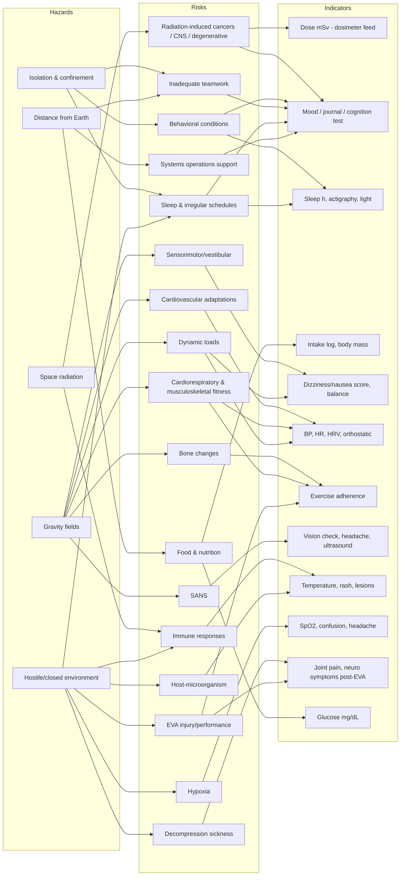

# EXPERT BRIEF: Astronaut Health Self-Assessment Tool (NASA Space Apps 2026)

Compiled 2026-11-14 from the research files in this folder: `challenge_raw.txt`, `map_physiology.md`, `map_hazards_behavior.md`, `map_studies.md`, `papers_physiology.md`, `papers_monitoring.md`, `winners_2025.md`.

Conventions:
- Every factual claim carries a source URL, or a short key that section 9 expands.
- **[inference]** marks our own design reasoning, not a sourced fact.
- **[standard clinical]** marks a general adult terrestrial clinical cut-off. These guideline pages were *not* fetched during this research. Verify each one against the named guideline before it goes in the demo, and present them as editable defaults that a flight surgeon would override.
- No numbers are invented. Anything a source did not give is marked "not stated" or "not retrieved".

Source keys used inline: CH = challenge text (`challenge_raw.txt`, https://www.spaceappschallenge.org/ challenge page); R-xxx = NASA HRP risk page (https://www.nasa.gov/reference/<slug>/); H-xxx = NASA HRP hazard page; NTRS-n = https://ntrs.nasa.gov/citations/n; PMID-n = https://pubmed.ncbi.nlm.nih.gov/n/. The full list is in section 9.

---

## 1. Challenge decoded

### 1.1 Objectives (must-haves, from CH)
- [ ] Build a **visual tool** that helps astronauts **assess their own health** during missions.
- [ ] Provide **guidance on treatments and health improvements**.
- [ ] **Gather health indicators** through any input: keyboard, mouse clicks, camera images.
- [ ] Support indicators such as BP, HR, **blood sugar in mg/dL**, body temperature, **daily sleep hours**, mood, and **ultrasound images**.
- [ ] Let astronauts **evaluate and act on** their health status.
- [ ] Ground the choice of indicators in NASA HRP resources and other agencies' public resources (the CSA pages are listed in CH).
- [ ] Answer the five guiding questions:
  - Which measurements can be done in space?
  - Why is each exam needed?
  - How do spaceflight hazards affect each indicator?
  - **When should a result go to the crew or the flight surgeons?**
  - What actions prevent a critical condition?
- [ ] Present metrics and diagnosis clearly. Animation and interactivity are suggested, including a **clickable human figure** that shows each body part's function and health status.

### 1.2 Potential considerations (optional, from CH)
- [ ] Insights for different environments: spacecraft, space station, rover, planetary or lunar base.
- [ ] **Routine prompts** to take measurements or do actions as part of the mission schedule.
- [ ] **Gamification** to drive health tasks.
- [ ] **Dynamic charts** of indicators over time.
- [ ] **Color coding** for at-a-glance status.
- [ ] **Simple instructions and explanations** for measurements, indicators and risks. CH says: "Do not assume that astronauts know everything."

### 1.3 Implicit judging questions
The rubric is Impact, Creativity, Validity, Relevance and Presentation, each scored 1-5 at every level (https://www.spaceappschallenge.org/resources/judging-awards-guide/). Each criterion implies questions a judge will ask:

- **Relevance:** Are NASA data and evidence core to the product, not decoration? Are the 5 hazards and the HRP risks visibly wired into the logic?
- **Validity:**
  - Is it scientifically right? For example, does it know that in-flight BP runs about 8-10 mmHg lower (PMID-25774397) and that resting core temperature rises about 1 °C (PMID-29170507)?
  - Is it feasible with devices that actually fly (Tempus Pro, Bio-Monitor, ultrasound)?
  - Is it usable by a tired astronaut?
- **Impact:** Does it address Earth-independent medical operations (EIMO)? NTRS-20230014109 describes crews on deep-space missions without real-time ground support. Does it have an Earth spin-off, such as remote or rural telehealth [inference]?
- **Creativity:** Does it go beyond "a vitals dashboard"? Candidate differentiators are a personal in-flight baseline, mission-environment awareness, delay-aware escalation, and a body map.
- **Presentation:** Can a judge understand it in a 30-second video or a 7-slide deck? The 2026 guide prints a 7-slide limit for a deck or a 30-second limit for a video (see `winners_2025.md` section 4); verify against the final submission guide before relying on them.

---

## 2. Problem map

### 2.1 Diagram
The 17 risks below are the HRP risk pages we downloaded (`raw/sub/reference_risk-*.txt`). The hazard links follow https://www.nasa.gov/hrp/hazards/ and the hazard and risk pages. Some risk-to-hazard edges are our grouping [inference].



### 2.2 Table

| # | Hazard(s) | HRP risk | Health effects (sourced) | Measurable indicators for the app | Source |
|---|---|---|---|---|---|
| 1 | Radiation | Radiation-induced cancers (+ CNS, heart, vessels, eyes) | Cancer. Degenerative heart, vessel and eye disorders. Cognitive or performance impairment. Exposure beyond the magnetosphere is higher than on ISS. | Cumulative dose from a dosimeter, solar particle event (SPE) alert, cognition trend [inference] | R-radiation-induced-cancers, H-space-radiation |
| 2 | Isolation | Behavioral conditions & psychiatric disorders | Anxiety and depression, affecting sleep, morale and decision making | Mood scale, journal, PVT/cognition [inference on set] | R-behavioral |
| 3 | Isolation, distance | Inadequate teamwork | Conflict in a small space. Communication delay makes it worse. | Weekly cohesion pulse [inference] | R-teamwork |
| 4 | Isolation, closed environment | Sleep & irregular schedules | Sleep loss and circadian desync. ISS crews see 16 sunrises a day. | Sleep hours, actigraphy, light, caffeine | R-sleep |
| 5 | Distance | Systems operations support | Earth-independent operation, more training needed | Procedure-confidence rating [inference] | R-systems-ops |
| 6 | Distance | Food & nutrition | Menu fatigue, performance decline, illness | Intake log, appeal rating, body mass | R-food |
| 7 | Gravity | Sensorimotor/vestibular | Motion sickness ("majority" of astronauts), disorientation at landing | Nausea and dizziness score, balance test | R-sensorimotor |
| 8 | Gravity | Cardiovascular adaptations | Clots, arrhythmia, low BP and fainting at landing. Heart becomes more spherical. | BP, HR, HRV, orthostatic check, leg swelling | R-cardiovascular |
| 9 | Gravity | Bone changes | Density loss of 1-1.5% per month, fracture risk | Exercise adherence as a proxy | R-bone |
| 10 | Gravity | Cardiorespiratory & musculoskeletal fitness | Strength and aerobic loss of 10-12% on average | Workout log, HR response | R-fitness |
| 11 | Gravity | SANS | Optic disc swelling, folds, globe flattening (~70% have some swelling) | Vision self-check, headache, ocular ultrasound | R-SANS |
| 12 | Gravity | Dynamic loads | Landing injury on a weakened body | Pre-landing readiness check [inference] | R-dynamic-loads |
| 13 | Radiation, closed env., sleep | Immune responses | Cold sores, rashes, allergies, infections, viral reactivation | Temperature, skin and lesion log | R-immune |
| 14 | Closed env. | Host-microorganism | Infection. Some microbes are more virulent in flight. | Fever, GI and skin symptoms [inference] | R-host-micro |
| 15 | Closed env. | Hypoxia | Confusion, headache, vision problems, poor sleep | SpO2, symptom checklist [inference] | R-hypoxia |
| 16 | Closed env. | Decompression sickness | Severe pain, breathing trouble, stroke-like signs | Post-EVA pain and neuro checklist | R-DCS |
| 17 | Closed env., gravity | EVA injury/performance | DCS, injury, fatigue in the suit | Fatigue, pain, pre-EVA readiness | R-EVA |

NASA says the hazards "feed off one another" (H-isolation / hazards page). The app should therefore show compound risk, for example a "cognitive readiness" view that combines sleep, mood and radiation [inference].

---

## 3. Indicator catalogue

Read this first: the NASA HRP pages give **no numeric thresholds** for BP, HR, SpO2, glucose or temperature (`map_physiology.md`, cross-cutting note 2). The thresholds below are therefore one of:
- **[standard clinical]** adult defaults to verify against the named guideline;
- **[inference]**;
- personal-baseline rules.

The recommended rule is to color against **the astronaut's own in-flight baseline**, with absolute clinical limits kept as a safety floor and ceiling [inference]. This follows NASA's own design: every flight study compares to the person's own baseline (`map_studies.md`).

Rule precedence **[inference]**: the displayed band is the worst of the baseline-relative rule and the absolute rule. A rolling baseline must never turn an absolute yellow or red green, and it should be frozen or flagged if it drifts toward a limit. Note that many flight findings below come from very small samples (for example n=7-9 astronauts in the BP, HR and arterial-stiffness studies; `papers_physiology.md`), so treat the numbers as indicative.

| Indicator | In-flight method / device | Units | Normal range (Earth) | Spaceflight change (numbers + source) | Green / Yellow / Red | Countermeasure / self-care | Escalation trigger |
|---|---|---|---|---|---|---|---|
| Blood pressure | Cuff via Tempus Pro or LifeBot 10 (NTRS-20240001624). CSA Bio-Monitor (CSA-BM). BP checks in Venous Haemostasis. | mmHg | <120/<80 [standard clinical, AHA 2017] | In-flight 24 h BP is 8-10 mmHg lower. SVR -39%. Cardiac output and stroke volume +35-41% (PMID-25774397). Postflight orthostatic intolerance: ~20% after short flights, 5 of 6 presyncopal after 129-190 d (PMID-11719623). | G: within ±10 mmHg of in-flight baseline and <130/80. Y: SBP 130-139 or DBP 80-89 [standard clinical], or SBP drop >20 mmHg on stand/after landing [standard clinical orthostatic definition]. R: ≥140/90 sustained, >180 and/or >120 (AHA crisis category), or SBP <90 with symptoms [standard clinical] | Fluids and compression garments before landing (R-cardiovascular). Re-measure seated after 5 min [standard clinical]. | Red, or symptomatic orthostasis: crew medical officer (CMO) now. Crisis-range BP or syncope: flight surgeon or PMC. |
| Heart rate | Bio-Monitor, Tempus Pro, ECG | bpm | 60-100 resting [standard clinical, AHA] | Sleeping HR unchanged in flight (n=7). Postflight 59.6 vs 53.3 bpm preflight. HRV reduced in flight (PMID-23637139). ~10 bpm higher supine and standing one day after landing (n=9, PMID-31414954). | G: within baseline ±15% [inference]. Y: >100 or <50 at rest, or ↑>30 bpm on standing [standard clinical]. R: >120 or <40 at rest, or irregular rhythm with symptoms [inference] | Rest, hydrate, re-measure | Palpitations, chest pain or syncope: CMO, then flight surgeon |
| SpO2 | Oximeter, Bio-Monitor, Tempus Pro | % | ≥95% [standard clinical] | Hypoxia risk from planned partial cabin depressurization. NASA calls it "relatively low" (R-hypoxia). | G ≥95. Y 91-94. R ≤90 [standard clinical] | Check cabin O2 and pressure. Rest. | Red, or confusion: CMO now. Check cabin systems. |
| Body temperature | Core or skin sensor, Bio-Monitor skin temp, Tempus Pro | °C | ~36.1-37.2 [standard clinical] | Resting core temperature rises ~1 °C over ~2.5 months. Exercise temperature runs higher and faster (PMID-29170507). | G: within baseline +0.5 °C [inference]. Y: +0.5 to +1.0 °C above *in-flight* baseline, or ≥38.0 °C [inference/standard clinical fever]. R: ≥39.0 °C, or ≥38.0 °C plus infection signs [inference] | Cool down after exercise. Fluids. Symptom log. | Fever with rash, lesions or GI symptoms: CMO (contagion risk to crew, see immunity article). Persistent: flight surgeon. |
| Blood glucose | Glucometer, finger-stick [inference: not named in our flight sources] | mg/dL | Fasting 70-99 [standard clinical, ADA] | Insulin-resistance index rose in flight, P<0.001 (PMID-26747504). In-flight glucose norms not retrieved. | G 70-99 fasting. Y 100-125 fasting, or 54-69 [standard clinical, ADA]. R <54 [standard clinical, ADA level 2 hypoglycemia], or ≥200 random with classic symptoms [standard clinical, ADA diabetes criterion]. A ≥250 hard stop is our own addition [inference]. | Eat fast carbohydrate if low [standard clinical]. Review intake. Exercise. | <54 or confusion: crew help now. Repeated yellow: weekly flight-surgeon review. |
| Sleep | Wrist actigraphy (Standard Measures, ARCHeR) plus self-report | h, efficiency % | 7+ h adults [standard clinical, AASM/SRS] | Actigraphy vs polysomnography in space: r=0.96 for duration, 0.88 for efficiency (NTRS-20040141770). 16 sunrises/day (R-sleep). | G ≥7 h. Y 5 to <7 h, or 2 short nights in a row. R <5 h, or 3+ nights <6 h [inference]. The worst-of rule applies. | LED light schedule, scheduled relaxation, caffeine timing (R-sleep) | Chronic red plus a cognition drop: CMO, adjust work schedule |
| Mood / stress | Short scale (POMS precedent, weekly, NTRS-20040088445), journal (R-behavioral) | 1-5 or 0-10 score | Personal | Shuttle/Mir crew mood was stable, but tension was displaced onto the ground (NTRS-20040088445) | G: baseline. Y: drop of 2+ points for 3 days [inference]. R: hopelessness or self-harm item [inference] | Journal, gardening, windows, privacy (R-behavioral). Contact family. | Red item: private psychological conference with the ground. Not shared with crew without consent [inference]. |
| Cognition / alertness | 3-min PVT (NTRS-20210022966), Reaction Self Test (NTRS-20090029851), Cognition Test Battery (NTRS-20205008023) | ms, lapses | Personal norm | Alertness predicted by past performance, fatigue, stress, temperature and radiation (NTRS-20210022966). "Space fog" up to 6 weeks (NTRS-20140016946). | Personal baseline: G within 10%, Y 10-20% slower, R >20% slower or many lapses [inference] | Nap, schedule shift, check CO2 (NTRS-20160013696) | Red before a critical task (EVA, piloting): defer the task, tell CMO |
| Vision / SANS | Near-vision card or Amsler grid [inference]. Fundoscope (R-SANS). OCT (B-Complex). Ocular ultrasound (NTRS-20050182738). | Pass/fail, symptoms | Normal acuity | ~70% of ISS astronauts have some swelling at the back of the eye (R-SANS). 5 of 7 had disc edema after ~6 months (PMID-21849212). | G: no change. Y: new near-blur or headache. R: sudden vision loss or field defect [inference] | Fluid-shift countermeasures under study (thigh cuffs, LBNP, PMID-33856253). B vitamin protocol (B-Complex). | Any new vision change: CMO plus a guided ultrasound or fundoscope image to the flight surgeon |
| Ultrasound (heart, neck veins, legs) | Self-scan (CIPHER Routine Ultrasound). Remote guidance with reference cards (NTRS-20050182738). | Image | — | Jugular flow changes (Venous Haemostasis). Heart becomes more spherical (R-cardiovascular). | No automatic color. Image quality checklist only [inference]. | Guided acquisition | Always store-and-forward to the flight surgeon. The app makes no diagnosis [inference]. |
| Exercise adherence (bone and muscle proxy) | Workout log, device data | min/day, sessions/week | ISS: 1.5 h/day, 6-7 days/week (R-fitness) | Bone loss 1-1.5%/month (R-bone); -0.8%/month in the lower limbs in a meta-analysis (PMID-32411816). Calf volume -13% despite exercise (PMC2988519). Fitness -10-12% (R-fitness). | G ≥ prescribed. Y <80% for a week. R <50% for 2 weeks [inference] | Resistive plus aerobic exercise. Alendronate plus ARED preserved lumbar BMD (PMID-41528521). | Persistent red, or new back pain: CMO (herniation risk 4.3x, PMID-27779600) |
| Body mass / intake | Mass measurement device, food log (Food Physiology study) | kg, kcal | Personal | Twins Study: decreased body mass (PMID-30975860; % not retrieved). Menu fatigue leads to weight loss (food-appeal article). | G: stable. Y: −2% [inference]. R: −5% from baseline [inference] | Food variety, weekly nutrition feedback | Red: flight surgeon / nutrition review |
| Motion sickness / balance | Symptom scale. Balance test (Standard Measures). | 0-10 | 0 | "Majority" get space motion sickness. Earth history does not predict it (R-sensorimotor). | G 0-2, Y 3-6, R ≥7 or vomiting >24 h [inference] | Medication, head-movement protocol, orientation aids (R-sensorimotor) | Persistent red: CMO. Dehydration risk. |
| DCS symptoms (post-EVA) | Checklist | Yes/no, pain 0-10 | None | — | Any joint pain, neuro or breathing symptom after a pressure change = R [inference from R-DCS] | Prebreathe protocol (R-DCS) | **End the EVA safely but rapidly and return inside** (R-DCS). Then CMO and flight surgeon. |
| Skin / infection signs | Photo plus checklist (camera input is allowed per CH) | Present/absent | None | ISS reports of cold sores, rashes, atypical allergies (R-immune). Viral reactivation can spread to crew (immunity article). | Y: new lesion. R: lesion plus fever, or spreading [inference] | Hygiene, isolate personal items [inference] | Red: CMO plus photo to the flight surgeon |
| Radiation dose | Dosimeters. CANS neutron spectrometer (CSA-RAD). Not self-measured. | mSv | — | Career limit 600 mSv. SPE limit 250 mSv/event (NASA-STD-3001, OCHMO-TB-020). Mars cruise ~1.8 mSv/day (from press coverage of the study: https://spaceflightnow.com/mars/msl/130530rad/, not the paper abstract). Shortest round trip 0.66 ± 0.12 Sv (PMID-23723233). Neutrons ~30% of ISS dose (CSA-RAD). | G <50% of the allocated mission budget. Y 50-80%. R >80%, or an active SPE [inference; limits from OCHMO] | Shelter during an SPE. Shielding cuts SPE dose ~50% but GCR only ~7% (OCHMO). | SPE alert: everyone to shelter, per vehicle procedure |

**Why each indicator is measured** (answers CH's "Why is an exam needed?"; row numbers refer to section 2.2; the one-line user-facing text still has to be written):

| Indicator | Why (HRP risk rows) |
|---|---|
| BP, HR | Cardiovascular adaptations, landing hypotension (8); fitness (10); dynamic loads (12) |
| SpO2 | Hypoxia (15); EVA (17) |
| Temperature, skin | Immune changes and infection (13, 14) |
| Glucose, body mass | Nutrition (6); metabolic change seen in flight |
| Sleep | Sleep and schedules (4); behavioral (2) |
| Mood, cognition | Behavioral (2); teamwork (3); radiation CNS effects (1); systems operations (5) |
| Vision, ultrasound | SANS (11); cardiovascular (8) |
| Exercise adherence | Bone (9); fitness (10) |
| Balance, motion sickness | Sensorimotor/vestibular (7); dynamic loads (12) |
| DCS checklist | Decompression sickness (16); EVA (17) |
| Radiation dose | Radiation (1) |

Thresholds tagged [standard clinical] come from:
- AHA 2017 BP categories: https://www.heart.org/en/health-topics/high-blood-pressure/understanding-blood-pressure-readings
- ADA hypoglycemia levels and fasting glucose: https://diabetes.org/
- AASM/SRS adult sleep ≥7 h: https://aasm.org/

None of these pages was fetched in this research. Verify each before the demo.

---

## 4. Mission context matrix

| Environment | One-way comm delay | Resupply | Medical autonomy | How the app must change [inference unless cited] |
|---|---|---|---|---|
| ISS (LEO) | Near real time [inference]; crew can talk to family and medical professionals today (R-behavioral) | Regular cargo. Blood samples returned within 37 h (immunity article). | Low. "Dozens" of ground staff carry medical tasks (NTRS-20230015503). Biomedical engineer (BME) sets up a Private Medical Conference (NTRS-20080026306). | "Call flight surgeon" is the default escalation. Full exercise equipment. Radiation inside the magnetosphere (R-cancer). |
| Orion / Artemis (cislunar) | Short lunar delays of 3-14 s are an evidence gap (NTRS-20250003885). "~1.3 s" is not sourced. | None during the flight | Medium. Small cabin. Artemis II runs Standard Measures (A2SM). | Limited equipment (Zero T2 rationale). Radiation beyond the magnetosphere. Motion-sickness check. Re-entry and landing readiness checklist. |
| Pressurized rover | Similar to the lunar base. Possible line-of-sight dropouts [inference]. | None | High: crew of 2, far from the habitat [inference] | Minimal-input mode, wearable-first. EVA/DCS module front and center. Dynamic-load check after a jolt (Occupant Protection page). |
| Lunar base | As lunar (above) | Sparse [inference] | Medium-high | Surface radiation ~0.5 mSv/day (OCHMO; a rough figure quoted for a surface-based mission, used there to derive a nuclear-technology limit). 1/6 g readiness after landing. Self-egress with no recovery team (R-dynamic-loads). |
| Mars transit / base | Up to 20 min one way (H-distance). "4-24 min" is not sourced. | None. Mission 2-3 years (NTRS-20200001715). | Highest: EIMO (NTRS-20230014109). Clinical decision support system concept (NTRS-20210025824). | Fully offline decision support. Store-and-forward packets with "earliest reply" ETA. Cruise dose ~1.8 mSv/day (press coverage of PMID-23723233: https://spaceflightnow.com/mars/msl/130530rad/). Orthostatic and readiness check at Mars arrival. Team and mood modules weighted up (R-teamwork). |

The app reads a single `environment` setting. That setting changes:
- the escalation path (ground first vs CMO first);
- the available devices and exercise equipment;
- the radiation budget and rate;
- the day length used for sleep logic [inference].

---

## 5. Existing systems and prior art

| System | What it does | Source |
|---|---|---|
| CHeCS (ISS Crew Health Care System) | Environmental Maintenance, Countermeasures and Health Maintenance systems | NTRS-20110011351 |
| Tempus Pro / LifeBot 10 | Multi-parameter vitals (BP, ECG, HR, EtCO2, RR, SpO2, temperature) plus ultrasound, with guided procedures | NTRS-20240001624; https://www.nasa.gov/reference/tempus-pro/ |
| CSA Bio-Monitor / Astroskin / Hexoskin | Smart shirt plus headband: ECG, BP, breathing, skin temperature, SpO2, activity | https://www.asc-csa.gc.ca/eng/sciences/bio-monitor.asp; NTRS-20190001996 |
| CANS (CSA) | Continuous autonomous neutron spectrometer; $5.5M contract | CSA-RAD |
| Spaceflight Standard Measures / ARCHeR / CIPHER | Research batteries: actigraphy, cognition, self-scanned ultrasound | SM, ARCHeR, CIPHER pages |
| Cognition Test Battery, Reaction Self Test, PVT | Cognitive and fatigue self-tests | NTRS-20205008023, -20090029851, -20210022966 |
| ExMC CDSS / Datascope / AMO | AI decision support for the CMO; AI ultrasound interpretation | NTRS-20210025824, -20240000914, -20180002541 |
| Integrated Medical Model | Monte Carlo risk model, ~100 conditions; ~10% under-prediction (Shuttle), ~20% over-prediction (ISS) | NTRS-20190001886 |
| CHP-IDA | Data backend that syncs "as communication delay permits" | NTRS-20240008508 |
| Past Space Apps entries | OrbitWATCH 2015 (HR plus radiation watch); Canaria 2016 (HR/SpO2/CO2 earpiece); Microdoze 2018 (baseline-deviation alerts); AstroMentis 2018 (diary AI); Morpheus Sleeptech 2020 (Global Nominee) | `winners_2025.md` section 5 |

**The gap we fill [inference]:**
- NASA systems are device- or research-centric, or aimed at the CMO and ground.
- Past Space Apps entries are mostly single-signal hardware concepts.
- No prior project we found combines all of the following in one **crew-facing** self-assessment UI:
  - vitals, mood, sleep and imaging;
  - **personal in-flight baselines**;
  - **delay-aware escalation tiers** (self, CMO, flight surgeon);
  - **environment awareness**;
  - plain-language "why this exam" explanations tied to HRP risks.

---

## 6. What the 2025 winners did, and lessons

Facts are from `winners_2025.md` and https://www.nasa.gov/learning-resources/stem-engagement-at-nasa/nasa-announces-2025-international-space-apps-challenge-global-winners/.

- **Scale:** 114,000+ participants, 11,500+ submissions, 10 winners, 45 finalists.
- **The only astronaut-health winner** is SpaceGenes+ (Best Use of Science, a 1-person team). It is a researcher dashboard of radiation × microgravity gene synergy built on GeneLab GLDS-288.
- **Common traits among winners:**
  - A live web demo (8 of 10 have deployed URLs).
  - A single risk score or alert: Astro Sweepers' ASRI, SkySense's risk windows, PureFlow's live space-weather alerts.
  - Real NASA APIs and data: POWER, DONKI, GeneLab, MAST.
  - A strong story, with Storytelling and Art & Tech awards going to narrative and game projects.

**Lessons [inference]:**
1. Ship a deployed demo, not slides only.
2. Put real NASA numbers in the logic and show the source in the UI ("why this threshold"). That covers Validity and Relevance.
3. Give one headline readiness score, but let the user drill down into it.
4. A small, well-scoped game element helps (Zumorroda-X won Art & Tech with a data game).
5. The crew-facing health niche is open in 2025.
6. NASA biomedical datasets exist (OSDR, cited via PMID-38744887 for Inspiration4) and could seed synthetic demo crews.

---

## 7. Recommended solution: "VITALIS" (working name)

### 7.1 MVP features (hackathon weekend)
1. **Clickable body map** with 8 systems: brain/cognition, eyes, heart/vessels, lungs/O2, bones/muscle, gut/nutrition, skin/immune, mind/sleep. Each system shows:
   - its status color;
   - a "what this does / how space affects it" card, using the sourced numbers from section 3;
   - its last readings.
2. **Quick check-in** that takes under 60 s:
   - BP, HR, SpO2, temperature, glucose (mg/dL), sleep h and mood;
   - manual entry plus a "from wearable" simulated feed.
3. **Personal-baseline color engine:**
   - green, yellow and red bands from the in-flight rolling baseline, inside the clinical floor and ceiling;
   - color always paired with an icon and text;
   - each band shows its source tag.
4. **Guidance cards** for every yellow and red result: what to do now, a re-measure timer, the countermeasure (from the NASA page), and a **who-to-call** tier.
5. **Escalation packet:** one tap builds a summary (last 72 h trend plus symptoms plus images) for the CMO or flight surgeon. It shows the delay-aware ETA (at least 2 × the one-way delay; ~40 min at the 20-min upper bound on Mars).
6. **Environment selector** (ISS / Orion / rover / lunar base / Mars). It changes the delay, escalation path, equipment, radiation rate and prompt schedule.
7. **Dynamic charts:** 7- and 30-day trends with baseline bands. Annotate expected shifts, for example "in-flight 24 h BP ~8-10 mmHg lower was observed in 8 ISS astronauts" (PMID-25774397).
8. **Routine prompts** batched to the crew schedule (wake, pre-exercise, pre-sleep). There is a cap on daily prompts, because task saturation is an explicit risk (NTRS-20230015503).

### 7.2 Stretch features
- Guided ultrasound: landmark reference card overlay plus an image quality checklist plus store-and-forward. Follows the NTRS-20050182738 model.
- A 3-min PVT mini-game as a cognition/readiness test.
- Pre-landing / pre-EVA readiness checklists (orthostatic, vestibular, DCS).
- A radiation panel fed by a simulated dosimeter (cumulative vs the 600 mSv career limit, SPE shelter alert).
- Crew view: anonymized team readiness (no individual medical detail).
- Camera input for skin lesions and the vision chart.
- An offline LLM explainer: answers come only from bundled NASA text and are always cited [inference].

### 7.3 Data model (minimal)
```
Astronaut {id, name, role(CMO?), preflightBaseline{indicator: mean, sd}, prescriptions{exerciseMinPerDay}}
Mission {environment: ISS|ORION|ROVER|LUNAR|MARS, oneWayDelaySec, equipment[], radRateMsvDay, dayLengthH}
Measurement {id, astronautId, indicator, value, unit, ts, source: manual|wearable|device|image, context: rest|post-exercise|post-EVA|pre-landing}
Symptom {id, astronautId, code, severity0to10, ts, note, photoRef?}
Assessment {measurementId, band: GREEN|YELLOW|RED, ruleId, baselineDelta, sourceTag}
Rule {id, indicator, type: absolute|baselineRelative|trend, thresholds, sourceUrl, evidenceTag: NASA|clinical|inference}
Action {ruleId, text, countermeasureUrl, escalationTier: SELF|CMO|SURGEON|EMERGENCY}
EscalationPacket {id, astronautId, created, contents[], sentAt, etaReply}
Task/Quest {id, type: measure|exercise|journal|sample, schedule, streak, points}
```

### 7.4 UI concept
- **Home:** the astronaut figure centered. Systems glow green, yellow or red. A top bar shows the mission environment, comm delay and dose. A single "Readiness" ring with drill-down.
- **System detail:** chart with a baseline band, latest values, "why we measure this" (HRP risk link), actions.
- **Alerts:** only red interrupts. Yellow stays in the inbox. Every alert carries a next action (alarm-fatigue design; NTRS-20140002818 is SLS firing-room display practice, not medical, so this is a borrowed principle [inference]).
- **Gamification:**
  - streaks for exercise adherence (bone rationale) and daily check-ins;
  - a "grow a plant" visual tied to journaling and mood (garden study);
  - crew mission badges;
  - no leaderboards on health values [inference].
- **Animation and interactivity** (CH suggests both): body-map systems pulse or glow by status, charts animate new readings into the baseline band, and tapping a system opens its detail card.
- **Accessibility:** large tap targets for gloves or low light. Color plus shape plus text [inference].

### 7.5 Demo scenario (about 30 s video or 7 slides)
1. Day 120 of a Mars transit. One-way delay is 18 min (illustrative; NASA cites "up to 20 minutes", H-distance).
2. The morning check-in shows temperature 37.6 °C. It stays **green** against the in-flight baseline, with the note "a ~1 °C resting rise was observed in ISS crews over ~2.5 months" (PMID-29170507; the authors also say such rises can impair performance, so the app does not call it "normal").
3. Sleep has been about 6.2 h for 3 nights (yellow, not the red rule of <6 h) and the PVT is 15% slower than baseline (yellow band 10-20%). Brain turns **yellow**. The app suggests a light-schedule change and a nap, and flags that the EVA tomorrow needs a re-check.
4. A new near-vision blur is reported. Eyes turn **yellow**. The app opens the guided ocular ultrasound, builds an escalation packet, and shows "flight surgeon reply ETA ≥36 min; CMO notified now".
5. The chart shows the 30-day trend. The streak badge keeps exercise at 100%, with the "bone loss 1-1.5%/month" card as the reason.
6. Switching the environment to ISS changes the escalation to "PMC with flight surgeon now". This shows environment awareness.

### 7.6 Scoring per criterion [inference]

| Criterion | How we score |
|---|---|
| Impact | Targets EIMO, the core problem for Mars (NTRS-20230014109). Earth spin-off for remote or rural telehealth. |
| Creativity | Personal in-flight baselines, a delay-aware escalation ETA, environment switching and a body map. No 2025 winner or finalist was a crew-facing vital-sign tracker (`winners_2025.md` section 3). Baseline-deviation alerts alone are not new: Microdoze (2018) had them. |
| Validity | Every threshold shows its source tag. Devices that really fly. Prompt cap for workload. Clear disclaimers. |
| Relevance | All 17 HRP risks and 5 hazards are wired into the rules. NASA numbers are in the logic. Every guiding question in CH is answered per indicator (see the "why measured" map after section 3's table). |
| Presentation | One concrete Mars-day story, a live deployed demo, and a clean visual body map |

---

## 8. Pitfalls and open questions

**Pitfalls [inference unless cited]**
- **Medical disclaimer:** present the tool as decision *support* that augments the crew. That matches ExMC's CDSS framing (NTRS-20210025824). Say "Not a diagnostic device" on every red card. Ultrasound gets no automatic diagnosis.
- **Alarm fatigue:** we found no NASA source on alarm fatigue in space medical UIs (`papers_monitoring.md`). Mitigations:
  - only red interrupts;
  - trend and baseline rules, not single readings (garden microbe page: trends matter);
  - batched prompts and a prompt cap;
  - speech or plain-language alerts (NTRS-20150021135).
- **False precision:** the IMM under-predicted about 10% of modeled conditions for Shuttle and over-predicted about 20% for ISS (NTRS-20190001886; this is a share of conditions mispredicted, not an error margin on each estimate). Show bands and ranges, not "73.4% risk". Clinical cut-offs are Earth-population values and do not hold in flight (BP and temperature shift).
- **Privacy:** NASA calls privacy a top priority (R-behavioral). Mood and psych data stay private by default, with a separate private-conference path. The crew view shows only readiness. Under-reporting risk: crews displaced tension onto the ground (NTRS-20040088445).
- **Workload:** each extra prompt costs crew time (NTRS-20230015503). Prefer wearable auto-capture.
- **Hard-coded dose limits:** use the NASA-STD-3001 values (600 mSv career, 250 mSv SPE) with the source shown, and keep them configurable.

**Open questions**
1. Validated in-flight reference ranges for glucose, sleep hours and HR are not retrieved. Do we need NASA-STD-3001 Vol 1/2 or HRP Evidence Reports (NTRS)?
2. A primary source for lunar delay (~1.3 s) and Mars delay (4-24 min). Currently we cite "up to 20 min" (H-distance) and "3-14 s lunar scenario" (NTRS-20250003885).
3. Is a glucometer part of the ISS or Artemis medical kit? Not stated in our sources.
4. Exact 2026 submission limits (30 s video? 7 slides?). Confirm in the final guide.
5. Which validated short mood scale can be used without licensing issues? POMS item set and scoring were not retrieved.
6. The PMC and private psychological conference protocol details beyond NTRS-20080026306.
7. Evidence for gamification in crews was not found.

---

## 9. Full source list

**Challenge and judging**
- Challenge text: `research/challenge_raw.txt` (Space Apps 2026 challenge page, https://www.spaceappschallenge.org/)
- https://www.spaceappschallenge.org/resources/judging-awards-guide/
- https://www.spaceappschallenge.org/2025/awards/
- https://www.nasa.gov/learning-resources/stem-engagement-at-nasa/nasa-announces-2025-international-space-apps-challenge-global-winners/
- https://api.spaceappschallenge.org/graphql

**NASA HRP hazards and overview**
- https://www.nasa.gov/hrp/hazards/
- https://www.nasa.gov/hrp/risks/
- https://www.nasa.gov/hrp/ongoing-hrp-research/
- https://www.nasa.gov/hrp/hazard-space-radiation/
- https://www.nasa.gov/hrp/hazard-isolation-and-confinement/
- https://www.nasa.gov/hrp/hazard-distance-from-earth/
- https://www.nasa.gov/hrp/hazard-gravity-fields/
- https://www.nasa.gov/hrp/hazard-hostile-closed-environments/

**NASA HRP risk pages** (prefix https://www.nasa.gov/reference/)
- risk-of-radiation-induced-cancers/
- risk-of-behavioral-conditions-and-psychiatric-disorders/
- risk-of-inadequate-teamwork/
- risk-from-inadequate-sleep-and-irregular-schedules/
- risk-of-inadequate-systems-operations-support/
- risk-of-inadequate-food-and-nutrition/
- risk-of-altered-sensorimotor-and-vestibular-function/
- risk-of-cardiovascular-adaptations/
- risk-of-spaceflight-induced-bone-changes/
- risk-of-reduced-cardiorespiratory-and-musculoskeletal-fitness/
- risk-of-spaceflight-associated-neuro-ocular-syndrome-sans/
- risk-of-injury-from-dynamic-loads/
- risk-of-altered-immune-system-responses/
- risk-of-host-microorganism-interactions/
- risk-of-hypoxia/
- risk-of-decompression-sickness/
- risk-of-injury-and-compromised-performance-from-extravehicular-activity-eva/

**NASA study pages** (prefix https://www.nasa.gov/reference/)
- standard-measures/
- artemis-ii-standard-measures/
- archer/
- cipher/
- tempus-pro/
- b-complex/
- thigh-cuff/
- venous-haemostasis/
- spinal-fluid-biomarkers/
- brain-fluid-pressure/
- zero-t2/
- simulating-manual-piloting-for-moon-landings/
- spacecraft-occupant-protection/
- immune-biomarkers/
- omics-archive/

**NASA articles**
- https://www.nasa.gov/missions/station/astronauts-spines-under-scrutiny/
- https://www.nasa.gov/missions/station/scientists-probe-how-long-term-spaceflight-alters-immunity/
- https://www.nasa.gov/missions/station/enhanced-diet-may-help-astronauts-adapt-to-spaceflight/
- https://www.nasa.gov/humans-in-space/how-does-spaceflight-change-food-appeal/
- https://www.nasa.gov/humans-in-space/can-space-gardening-help-astronauts-cope-with-isolation/
- https://www.nasa.gov/missions/station/researchers-put-space-garden-microbes-under-the-microscope/
- OCHMO radiation brief: https://www.nasa.gov/wp-content/uploads/2023/03/radiation-protection-technical-brief-ochmo.pdf

**CSA**
- https://www.asc-csa.gc.ca/eng/news/articles/2026/2026-02-26-monitoring-radiation-astronaut-health.asp
- https://www.asc-csa.gc.ca/eng/iss/science/why-do-we-conduct-science-experiments-in-space.asp
- https://www.asc-csa.gc.ca/eng/sciences/bio-monitor.asp

**NTRS** (prefix https://ntrs.nasa.gov/citations/)
- 20230014109, 20240001402, 20250000009, 20240000914, 20240002454, 20230015503
- 20210022439, 20205008379, 20200001715, 20230001365, 20240008508
- 20210025824, 20220017856, 20205008927, 20180002541, 20170010678, 20240001624
- 20150002713, 20150022114, 20170001541, 20110023074, 20190001886
- 20110011351, 20090032068, 20080026306
- 20190001996, 20190000238, 20180008707, 20150021842, 20160005394
- 20050182738, 20110011352
- 20205008023, 20190025239, 77794093696409, 20090029851, 20210022966
- 20040088701, 20040088445, 20140016946, 20160013696
- 20040141770, 20040088714, 20190025160
- 20250003885, 20150021135, 20140002818

**PubMed** (prefix https://pubmed.ncbi.nlm.nih.gov/)
- 23637139, 31414954, 25774397, 26747504, 11719623, 15198285, 16676655, 42741837
- 29170507, 30975860, 32411816, 41528521, 27779600
- 33856253, 21849212, 39483988, 38862026, 38744887
- 23723233, 11604093

**Other**
- https://pmc.ncbi.nlm.nih.gov/articles/PMC2988519/
- https://www.scientificamerican.com/blog/news-blog/spaceflight-wreaks-havoc-on-astrona-2009-04-08/
- https://spaceflightnow.com/mars/msl/130530rad/
- https://www.npr.org/sections/health-shots/2013/05/30/187164731/Headed-To-Mars-Watch-Out-For-Cosmic-Rays
- https://en.wikipedia.org/wiki/Hexoskin (low reliability)

**Past Space Apps**
- https://2015.spaceappschallenge.org/project/orbitwatch/
- https://www.iot-now.com/2016/06/06/48175-university-surrey-students-project-canaria-wins-global-nasa-spaceapps-challenge-2016/
- https://2016.spaceappschallenge.org/challenges/space-station/rock-it-space-fashion-and-design/projects/hearts-in-orbit
- https://www.siliconrepublic.com/machines/3-winners-of-nasa-space-apps-challenge-hackathon-revealed
- https://2018.spaceappschallenge.org/challenges/can-you-build/bring-your-own-solution/teams/astromentis
- https://2020.spaceappschallenge.org/challenges/sustain/sleep-shift-scheduling-tool
- https://2022.spaceappschallenge.org/challenges/2022-challenges/space-biology-superhero/teams/tardinauts

**2025 winner projects**
- https://spacegenes-plus.framer.website/
- https://resonant-planet.vercel.app
- https://skysense.surf/
- https://astro-sweepers.vercel.app/
- https://larasdiniz.github.io/PureFlow-2025/src/public/html/home/home.html
- https://a-solar-tale.netlify.app/
- https://henrysfarmadventures.vercel.app/
- https://quenaris.vercel.app

**[standard clinical] references (not fetched; verify)**
- AHA BP categories: https://www.heart.org/en/health-topics/high-blood-pressure/understanding-blood-pressure-readings
- ADA glucose: https://diabetes.org/
- AASM/SRS sleep: https://aasm.org/
